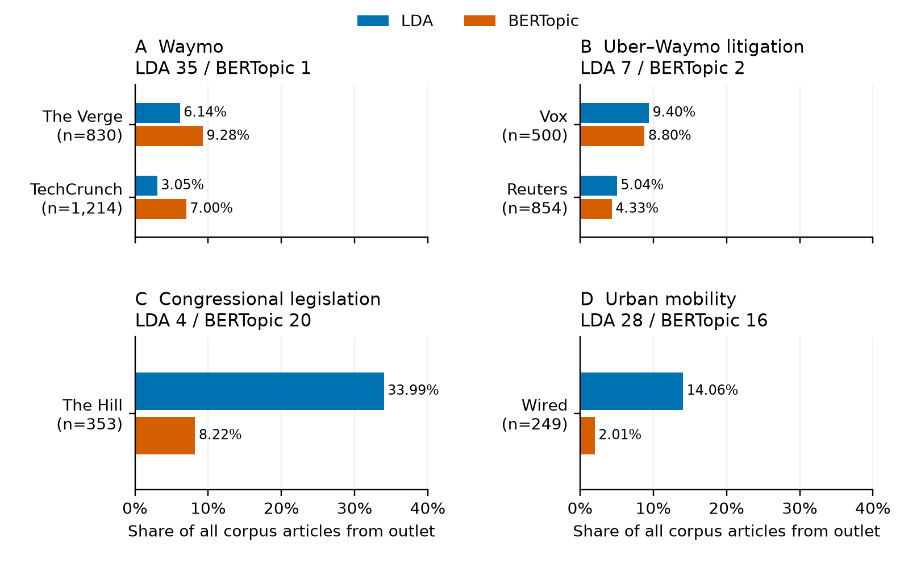
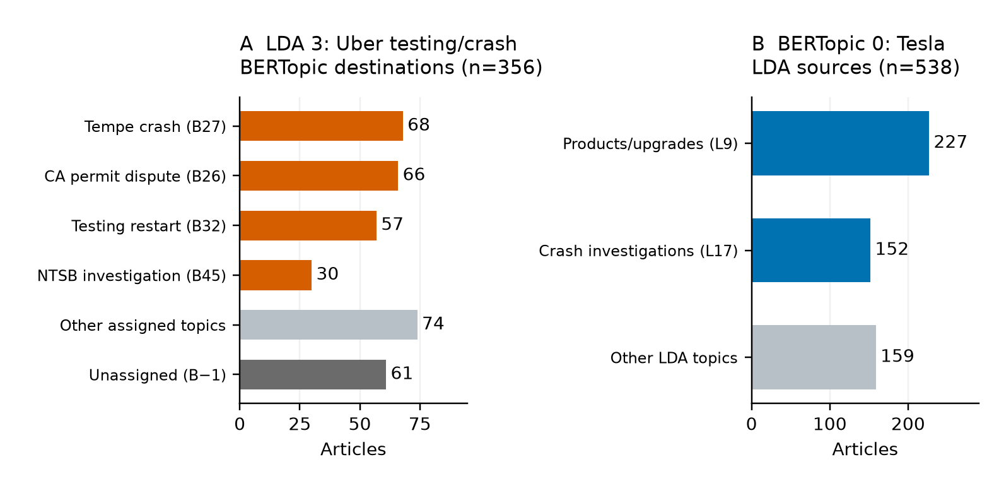

# PR3 results and interpretation notes

Prepared November 25, 2026; updated November 26, 2026 following approval of the substantive interpretations on `mkc/model-comparison`. This is a separate handoff document; the PR3 manuscript, existing tables and figures have not been edited.

## Current status and main findings

Mary Kate explicitly selected **BERTopic n30_c25_s42** after reviewing the shortlist recommendation. Both selected pipelines have now been evaluated on the same 7,332-article corpus. The six original BERTopic seed-42 fits and original LDA numerical exports were reused. BERTopic seeds 7 and 21 were added. The complete inventories below now use the 40 approved LDA labels and 70 approved BERTopic labels; original assistant drafts remain preserved in separate CSVs. **Mary Kate has now explicitly approved all 110 labels during guided review; no naming decisions remain pending**, as recorded in the follow-up section. These naming decisions are not independent ratings. Frozen review packets are now prepared after Mary Kate’s reservation attestation; independent human ratings remain pending.

The two methods recover recognizable deployment, regulation, safety, litigation, supply-chain and mobility themes. BERTopic has higher mean coherence, while LDA has higher keyword diversity and assigns every article. BERTopic retains a substantial unassigned group. Neither model is uniformly superior on these measures, and these exploratory results do not establish human-perceived accuracy or out-of-sample generalization.

| Work item | Current status as of November 26, 2026 |
| --- | --- |
| Selected models and computational comparison | Complete for LDA `lda_k40_s42` and BERTopic `n30_c25_s42`; robustness findings and limitations documented below |
| Topic naming | All 40 LDA and 70 BERTopic labels approved by Mary Kate and transferred |
| Shared-reservation attestation and frozen packet | Complete; the same 100 articles are fixed for both reviewers |
| Three substantive conclusions | Approved by Mary Kate, including their qualifications, on November 26 |
| Independent article-fit evaluation | Genuine completed submissions and subsequent agreement analysis remain pending |
| New 30-article corpus audit | Complete November 26: 30/30 assisted judgments; 24 central, 5 peripheral, 1 not relevant; 7 boilerplate present; 4 malformed present and 2 uncertain |
| Report preparation | Main examples, figures and tables selected; [response to PR2 feedback](pr2-feedback.md) prepared November 26; manuscript integration and independent human results remain |

The November 26 approval completes Mary Kate’s review of the three interpretations below. It does not require another approval of the same conclusions. Any additional team review is separate and has not been inferred.

## Approved substantive interpretations — November 26, 2026

Mary Kate explicitly approved all three interpretations and their presented qualifications with “I approve these interpretations.” The [dated decision record](../code/modern-methods/Results/robustness/2026-11-26/interpretation_review/approved_interpretations.json) preserves the approved wording, numeric examples, scope and source hashes. This is Mary Kate’s assisted interpretation review, not independent fit ratings, corpus-audit judgments, or evidence of approval by other team members.

1. **Recurring themes coexist with format-driven clusters.** Both pipelines recover recognizable themes concerning autonomous-vehicle development, commercialization, safety, and governance. Some clusters instead reflect publication-specific formats or mixed coverage, limiting their interpretation as distinct substantive themes. Approved labels do not establish uniform fit across every article.
2. **Publication differences depend on topic definition and model stability.** The Verge’s higher Waymo share than TechCrunch’s is comparatively persistent across the checked configurations, LDA seeds and shared period, although matched topics differ in breadth. Vox’s higher litigation share than Reuters’ persists across the six BERTopic configurations and the shared period but reverses under LDA seed 7. The Hill’s congressional share (33.99% LDA versus 8.22% BERTopic) and Wired’s urban-mobility share (14.06% versus 2.01%) illustrate substantial model dependence. These are corpus-specific shares, not measures of all outlet output, editorial intentions or public attitudes.
3. **Model choice changes topic boundaries and coverage without establishing an overall winner.** LDA and BERTopic provide complementary descriptions of this corpus. Their differences in topic boundaries, assignment coverage, and stability affect publication comparisons, so conclusions should be evaluated across models rather than selected solely by coherence. BERTopic’s stronger assigned-both seed agreement accompanies 18.04% unassigned articles; LDA provides complete assignment coverage and mixtures but greater initialization sensitivity. Event splitting and Tesla-topic merging show that more topics do not guarantee finer distinctions everywhere. Superior human-rated fit remains unestablished.

These three conclusions are approved for use in the report with their qualifications. Independent ratings, the new corpus audit, remaining report preparation and any separate team review are distinct tasks. The frozen evaluation inputs remain unchanged.

## Model selection and development evidence

| BERTopic run | Topics | Mean c_v | Diversity | Unassigned | Cosine silhouette |
| --- | --- | --- | --- | --- | --- |
| n15_c25_s42 | 76 | 0.6921 | 0.6434 | 20.24% | 0.1144 |
| n15_c50_s42 | 40 | 0.6622 | 0.6225 | 19.93% | 0.1192 |
| n15_c100_s42 | 21 | 0.6408 | 0.5857 | 14.61% | 0.1050 |
| n30_c25_s42 | 70 | 0.7047 | 0.6514 | 18.04% | 0.1217 |
| n30_c50_s42 | 35 | 0.6455 | 0.6000 | 19.08% | 0.1227 |
| n30_c100_s42 | 24 | 0.6295 | 0.6083 | 22.20% | 0.1340 |

Source: [six-run experiment table](../code/modern-methods/Results/modern/experiments.csv). Silhouette uses original normalized embeddings, excludes outliers and samples at most 2,000 assigned articles; it is not directly comparable with an LDA score.

The primary shortlist was n30_c25_s42, n15_c25_s42 and n15_c50_s42. The selected run improves coherence and assignment coverage over the other two shortlisted runs while preserving specific themes in the examined articles. The 40-topic n15_c50 alternative offers coarser summaries, but matching LDA's topic count is not itself a quality criterion. The 21-topic n15_c100 run has the lowest unassigned fraction and is a credible coverage-focused alternative; n30_c50 and n30_c100 provide different coarse partitions without leading on coherence. Model choice is a documented exploratory tradeoff, not a statistically established optimum.

The [current shortlist review](../code/modern-methods/selection_review/current_shortlist_review.csv) covers each candidate's five largest, three lowest-coherence and three smallest assigned topics, deduplicated within run: **33 topic/run pairs and 70 distinct articles**. It records current representative IDs and manifest hashes. Review used keywords, titles, and opening/middle/ending article passages; it was not an exhaustive reading of approximately 119,000 words of full text. These are assistant development assessments, not independent human scores. No cited development IDs intersect the 100 reserved review IDs. The older suggested-score CSV remains historical evidence and does not consistently correspond to current topic IDs/examples.

Examples supporting the choice include Uber-Waymo litigation (1341648, 1450043, 1921486), Waymo deployment (546719, 484629, 546490), Roborace (1112028, 540914, 534886), and Las Vegas autonomous rides (548701, 845221, 549015). Counterexamples include TechCrunch roundups (411242, 323085, 360683), mixed transportation newsletters (449680, 270478, 498671), and conversational technology essays/interviews (218059, 1335182, 138257). Agreement among syndicated or near-duplicate stories is not independent evidence of general cluster quality.

The authoritative choice and selector are recorded in [selection.json](../code/modern-methods/Results/modern/selection.json).

## Data, configurations and evaluation definitions

The shared filtered corpus contains **7,332 articles from 25 publications**, dated January 2016 through March 26, 2020. Exact duplicate article bodies were removed; near duplicates, updates and syndicated text can remain. Both pipelines use corpus hash `c73293f76ba4b0a18d685e5724f75b1123a86c9012497fc324090989642a8f99`. The 100 reserved articles are excluded from development examples and naming, not from unsupervised model fitting.

- **LDA:** seed 42, K=40, batch variational fitting, 50 iterations, document-topic prior 0.1, topic-word prior 0.025. Unigram counts use shared tokenization plus English/custom stopword removal, exclusion of digit-only and short tokens, min_df=5 and max_df=0.5. Full mixtures are preserved alongside dominant assignments. [Selected configuration](../code/classical-methods/selected_configuration.json); [manifest](../code/classical-methods/results/manifest.json).
- **BERTopic:** normalized 384-dimensional GTE-small embeddings; tokenizer chunks of at most 480 tokens; token-weighted pooling. UMAP: 30 neighbors, 5 components, cosine metric, min_dist=0, seed 42. HDBSCAN: min_cluster_size=25, min_samples=10, Euclidean metric, excess-of-mass selection, prediction_data=True. Topic representations use c-TF-IDF with a fixed unigram vocabulary learned from individual articles (min_df=5, English stopwords). [Run manifest](../code/modern-methods/Results/modern/runs/n30_c25_s42/manifest.json); [embedding provenance](../code/modern-methods/Results/modern/embedding_pointer.json).
- **Coherence:** mean per-topic c_v using the top ten unigrams and the same shared full-corpus reference/tokenizer, window size 110; BERTopic topic -1 excluded. Vocabulary coverage is reported explicitly.
- **Keyword diversity:** distinct terms divided by all top-ten term slots across assigned topics.
- **Jaccard:** intersection divided by union of the two top-ten word sets. Best lexical matches retain ties and are not proof of semantic equivalence or a one-to-one alignment.
- **Publication shares:** dominant-topic article counts divided by all corpus articles from that publication. All 25 outlets remain separate, including Vice and Vice News. BERTopic outliers stay in denominators. Main heatmaps show the 15 largest topics plus unassigned for outlets with at least 50 articles; displayed subsets need not sum to one.
- **LDA mixture shares:** the existing PR3 heatmap averages full topic probabilities. It answers a different question from dominant-assignment proportions and must be captioned separately. Its outlet grouping also differs from these comparison tables.

## LDA results

The selected **lda_k40_s42** model produces 40 topics and assigns all 7,332 articles. Topic sizes range from 22 to 685 articles when each article is counted under its highest-probability topic. Its mean c_v is **0.6552**, with keyword diversity **0.7100** (284 distinct terms across 400 top-ten slots). The five largest dominant-assignment topics are:

| Topic | Approved label | Articles | Share of all 7,332 articles |
| --- | --- | ---: | ---: |
| 0 | Driving automation and human control | 685 | 9.34% |
| 22 | Lidar and autonomous-driving suppliers | 511 | 6.97% |
| 2 | Federal AV policy and safety regulation | 431 | 5.88% |
| 7 | Uber-Waymo trade-secret litigation | 409 | 5.58% |
| 3 | Uber testing and crash response | 356 | 4.86% |

The largest topics combine broad driving/human-control discussion, suppliers, federal policy, litigation and Uber testing/crash coverage. LDA also separates Tesla product/upgrades (topic 9, 257 articles) from Tesla crash investigations (topic 17, 192 articles). Full mixtures retain information beyond this dominant assignment: the mean largest topic probability is 0.4382, and 68.71% of articles have a largest probability below 0.5. These figures indicate diffuse topic mixtures, not classification errors. [Approved LDA topics](../code/classical-methods/results/topics.csv), [metrics](../code/modern-methods/Results/comparison/n30_c25_s42/model_metrics.csv), [mixture validation](../code/modern-methods/Results/comparison/n30_c25_s42/classical_validation.json).

LDA’s principal limitation in this study is initialization sensitivity: ARI against seed 42 is 0.3230 for seed 7 and 0.3469 for seed 21 across all articles. The Vox–Reuters litigation ordering reverses under seed 7, so full assignment coverage does not establish stable publication conclusions. Mixed interviews, newsletters and peripheral coverage remain among its approved labels.

## BERTopic results

The selected **n30_c25_s42** model produces 70 assigned topics covering **6,009 articles (81.96%)**, with **1,323 unassigned articles (18.04%)**. Assigned topics range from 25 to 538 articles. Mean c_v is **0.7047**, and keyword diversity is **0.6514** (456 distinct terms across 700 top-ten slots). The five largest assigned topics are:

| Topic | Approved label | Articles | Share of all 7,332 articles |
| --- | --- | ---: | ---: |
| 0 | Tesla Autopilot development, claims and safety | 538 | 7.34% |
| 1 | Waymo autonomous-driving development and deployment | 438 | 5.97% |
| 2 | Uber-Waymo trade-secret litigation | 334 | 4.56% |
| 3 | AV safety and deployment readiness | 302 | 4.12% |
| 4 | Technology interviews and essays (mixed themes) | 265 | 3.61% |

BERTopic identifies specific companies, events and policy disputes alongside broad themes. Examples include the fatal Uber pedestrian crash in Tempe (topic 27), the California testing-permit dispute (topic 26), Intel-Mobileye (topic 19), and Nvidia computing (topic 24). The large mixed interview/essay topic illustrates that clustering also captures writing format. More topics do not guarantee uniformly finer substantive distinctions: BERTopic’s largest Tesla topic combines much of LDA’s separate product and crash-investigation coverage. [Approved BERTopic inventory](../code/modern-methods/Results/modern/selected/n30_c25_s42/topic_inventory.csv), [metrics](../code/modern-methods/Results/comparison/n30_c25_s42/model_metrics.csv), [cross-model article overlap](../code/modern-methods/Results/comparison/n30_c25_s42/assignment_contingency.csv).

The assigned partition is comparatively stable across seeds 7 and 21 (ARI 0.9614 and 0.9760), but those statistics cover only articles assigned in both runs, approximately 77.5% of the corpus. Outlier-status agreement is approximately 91%. The unassigned fraction is therefore part of the result, not a removable nuisance category or evidence that those articles are irrelevant.

## Quantitative comparison

| Model | Topics | Mean c_v | Keyword diversity | Vocabulary coverage | Unassigned |
| --- | --- | --- | --- | --- | --- |
| BERTopic | 70 | 0.7047 | 0.6514 | 100.0% | 18.04% |
| LDA | 40 | 0.6552 | 0.7100 | 100.0% | 0.00% |

Sources: [model metrics](../code/modern-methods/Results/comparison/n30_c25_s42/model_metrics.csv), [per-topic LDA coherence](../code/modern-methods/Results/comparison/n30_c25_s42/classical_coherence.csv), [per-topic BERTopic coherence](../code/modern-methods/Results/comparison/n30_c25_s42/modern_coherence.csv). BERTopic leaves **1,323 articles unassigned**; that category is not a substantive topic. The 0.0495 difference in mean coherence is descriptive, not a significance test, and the models have different numbers and granularities of topics.

[Mixture checks](../code/modern-methods/Results/comparison/n30_c25_s42/classical_validation.json) confirm normalized rows, correct IDs, and agreement with dominant assignments and membership strengths. LDA's mean dominant probability is 0.4382 and median is 0.3974; 68.71% of articles have no topic probability above 0.5. This reflects mixed-topic representation, not measured error or calibrated prediction confidence.

### Interpretation of the comparison

BERTopic’s coherence exceeds LDA’s by **0.0495**, while LDA’s diversity exceeds BERTopic’s by **0.0586**. Diversity is a ratio: BERTopic has more distinct top words in absolute terms (456 versus 284) but also more term slots because it has 70 topics rather than 40. Coherence and diversity measure properties of topic words; neither measures whether the approved label fits each article. The 100% vocabulary coverage refers to those top words in the common coherence reference, not accuracy or coverage of every word in the corpus.

The models offer different representations. LDA provides full topic mixtures and complete dominant-assignment coverage, with substantial seed sensitivity. BERTopic provides many specific assigned clusters and higher assigned-both seed stability, while leaving a sizable share of articles unassigned. Article overlap shows both splitting and merging, so no one-to-one semantic mapping should be assumed. Publication differences must be evaluated with the same outlet denominators and with outliers retained.

The exploratory split retains BERTopic’s coherence advantage (0.6337 versus 0.6130), but 30.97% of held-out articles are unassigned. The shared-period and configuration checks support some selected publication directions while exposing others as model-dependent. These checks support a qualified comparison; they do not establish one universally superior model, untouched test performance, or independently validated human fit. Detailed denominators, topic matches and exceptions follow below.

## Seed stability and its limits

| Model | Comparison seed | ARI | Articles evaluated | Corpus evaluated | Outlier-status agreement |
| --- | --- | --- | --- | --- | --- |
| bertopic | 7 | 0.9614 | 5697 | 77.70% | 91.04% |
| bertopic | 21 | 0.9760 | 5678 | 77.44% | 91.13% |
| lda | 7 | 0.3230 | 7332 | 100.00% | 100.00% |
| lda | 21 | 0.3469 | 7332 | 100.00% | 100.00% |

Source: [seed stability](../code/modern-methods/Results/comparison/n30_c25_s42/seed_stability.csv). All comparisons use the seed-42 model as baseline. LDA ARI covers every article. BERTopic ARI covers only articles assigned in both runs: its high values must be reported together with the approximately 77.5% evaluated fraction and approximately 91% outlier-status agreement. LDA's outlier agreement of 100% is automatic because it has no outlier class.

BERTopic stability does not mean every topic or publication conclusion persists. Topic matching leaves six baseline topics unmatched at seed 7 and four at seed 21, with descriptive split/merge flags. For matched topic/outlet rows with at least 50 articles, the median absolute publication-share change is zero, but the 95th percentile is 0.99 percentage points (seed 7) and 0.91 (seed 21). Maximum changes are 9.38 points for the NYT business-roundup match at seed 7 and 7.65 points for The Hill policy-newsletter match at seed 21. These summaries exclude unmatched topics and therefore cannot establish stability of the entire partition. See [seed 7 matches and publication changes](../code/modern-methods/Results/modern/selected/n30_c25_s42/seed_7/publication_changes.csv) and [seed 21](../code/modern-methods/Results/modern/selected/n30_c25_s42/seed_21/publication_changes.csv).

LDA's ARIs of 0.323 and 0.347 indicate substantial seed sensitivity in dominant assignments. The new matched publication analysis below confirms meaningful changes, including a seed-7 reversal of the Vox–Reuters litigation comparison; do not claim its publication patterns are generally stable.

## Findings for the research questions

The interpretations in this section are approved by Mary Kate as of November 26, 2026, with the stated robustness, corpus-coverage and topic-definition qualifications. Supporting calculations remain descriptive; independent human-fit results are still pending.

### 1. What themes characterize AV news coverage?

Both methods identify Tesla/Autopilot, Waymo deployment, Uber-Waymo litigation, autonomous freight, safety regulation, automotive suppliers and urban mobility. Examples include LDA 7 / BERTopic 2 (litigation), LDA 35 / BERTopic 1 (Waymo), LDA 11 / BERTopic 7 (trucking), and LDA 4 / BERTopic 20 (Congress). These are approved, article-supported naming decisions; independent article-fit validation remains pending. The complete approved inventories below retain mixed, peripheral and format-driven qualifications rather than treating every cluster as a coherent AV theme.

### 2. How do themes differ across publications?

The following illustrative comparisons use identical publication denominators. They are examples, not exhaustive rankings or tests of editorial intent.

| Theme (LDA / BERTopic ID) | Publication | N | LDA count / share | BERTopic count / share |
| --- | --- | --- | --- | --- |
| Congressional legislation (4 / 20) | The Hill | 353 | 120 / 33.99% | 29 / 8.22% |
| Litigation (7 / 2) | Vox | 500 | 47 / 9.40% | 44 / 8.80% |
| Litigation (7 / 2) | Reuters | 854 | 43 / 5.04% | 37 / 4.33% |
| Waymo deployment (35 / 1) | The Verge | 830 | 51 / 6.14% | 77 / 9.28% |
| Waymo deployment (35 / 1) | TechCrunch | 1214 | 37 / 3.05% | 85 / 7.00% |
| Urban mobility (28 / 16) | Wired | 249 | 35 / 14.06% | 5 / 2.01% |
| Hill.TV interviews (1 / 67) | The Hill | 353 | 27 / 7.65% | 27 / 7.65% |

Sources: [LDA counts](../code/modern-methods/Results/comparison/n30_c25_s42/classical/publication_counts.csv), [BERTopic counts](../code/modern-methods/Results/comparison/n30_c25_s42/modern/publication_counts.csv), [matched shares](../code/modern-methods/Results/comparison/n30_c25_s42/matched_publication_proportions.csv).

The Hill's congressional coverage appears in both pipelines, but its magnitude differs substantially. Vox's litigation share exceeds Reuters' in both shown comparisons. The Verge's Waymo share exceeds TechCrunch's in both, although the BERTopic topic is broader. Wired's apparent urban-mobility emphasis changes sharply between models; keyword matching alone does not preserve the substantive conclusion. All 27 articles in both Hill.TV topics come from The Hill, illustrating how a publication-specific format can look like thematic specialization.

Unequal outlet dates, article counts, syndication and source-specific formats are alternative explanations. These are corpus-specific descriptive associations, not causal claims or measures of all output published by an outlet.

### 3. How does model choice affect the themes identified?

- **Shared themes:** LDA 7 / BERTopic 2 have Jaccard 0.667, with 319 of LDA 7's 409 articles assigned to BERTopic 2. LDA 35 / BERTopic 1 have Jaccard 0.538, with 195 of 211 articles overlapping.
- **Splitting:** LDA 3 groups Uber testing/crash stories. Its 356 articles distribute across BERTopic's fatal crash (68), California permit dispute (66), testing restart (57), NTSB investigation (30), and other topics; 61 are unassigned. A single best keyword match omits this structure.
- **Merging:** BERTopic 0 contains 227 articles from LDA's Tesla product topic 9 and 152 from its Tesla crash-investigation topic 17. More total topics does not imply finer separation of every theme.
- **Supplier detail:** LDA 14's 290 articles divide between Intel-Mobileye (78), Nvidia (60), other assigned topics and 72 outliers in BERTopic.
- **Shared failure modes:** the Hill.TV topics have Jaccard 0.667, matching the strong litigation overlap numerically. High overlap can capture formatting or source identity, not only valuable themes. BERTopic 47 also has embedded page-code terms; the preprocessing did not remove all page artifacts; the completed new assisted corpus audit records boilerplate in 7/30 articles and malformed text in 4/30, with 2/30 malformed judgments uncertain.

Sources: [assignment contingency](../code/modern-methods/Results/comparison/n30_c25_s42/assignment_contingency.csv) and [lexical matches with ties](../code/modern-methods/Results/comparison/n30_c25_s42/best_lexical_matches.csv). Do not equate every automatic best match with semantic equivalence.

## Selected main-report examples and figures — November 26, 2026

The [PR3 assignment](pr3-assignment.md) limits the manuscript to eight pages excluding references. Use **two focused results figures and two compact results tables**, plus a short audit paragraph in Data/Limitations. These are editorial selections based on the approved conclusions; they do not constitute new human ratings or additional approvals. The source files, counts and example metadata are recorded in the [selection record](../code/modern-methods/Results/robustness/2026-11-26/report_selection/selection.json). Existing manuscript, tables and figures remain untouched; new figure assets are saved separately.

### Main examples and their purpose

| Example | Placement and purpose | Qualification to retain |
| --- | --- | --- |
| Waymo: The Verge versus TechCrunch | Lead publication comparison; direction persists across the checked configurations, LDA seeds and shared period | Different topic breadth; corpus-specific outlet shares, not all published output |
| Uber–Waymo litigation: Vox versus Reuters | Pair with Waymo to show the limits of robustness | Selected fits and six BERTopic configurations agree on direction, but LDA seed 7 reverses it |
| Congressional legislation: The Hill | Show a recognizable theme whose measured share changes substantially: 33.99% LDA versus 8.22% BERTopic | Matched labels do not create identical topic definitions |
| Urban mobility: Wired | Show model dependence outside the corporate/legal examples: 14.06% LDA versus 2.01% BERTopic | The difference persists in the shared-period subset; do not rank overall outlet specialization |
| Uber testing/crash stories and Tesla coverage | Demonstrate splitting in one case and combining in another using actual shared article counts | More topics do not guarantee finer distinctions everywhere; retain other-topic and unassigned categories |
| Hill.TV Boundless interviews | Include one format-driven counterexample beside substantive themes | Both models assign the same 27 articles, all from The Hill; high overlap can reflect source/format rather than substantive AV coherence |

Select these cases deliberately to cover persistent, unstable, model-dependent and format-driven results. They are illustrative rather than a random or exhaustive sample of publication differences. Freight, lidar, AI, delivery, international trials and the other approved themes remain in the complete inventory; omitting them from the main examples is a page-budget decision, not a judgment that they are unimportant.

### Main topic table: eight rows, four paired examples

Use the following eight rows for a full-width topic table. They connect article-supported themes to the publication figure and include the explicit format-driven counterexample. Keep the approved names, sizes and three keywords; cite the representative articles in the caption or table notes rather than printing their full titles in narrow cells. For a public report, resolve these IDs to normal citations when integrating the manuscript; IDs alone are internal corpus references. Full top-ten terms and all 110 labels remain supporting material.

| Model/topic | Approved label | Articles | Three keywords | Representative ID |
| --- | --- | ---: | --- | --- |
| LDA 35 | Waymo driverless-service rollout | 211 | waymo, waymos, phoenix | 2340111 |
| BERTopic 1 | Waymo autonomous-driving development and deployment | 438 | waymo, waymos, krafcik | 546719 |
| LDA 7 | Uber-Waymo trade-secret litigation | 409 | uber, levandowski, waymo | 61037 |
| BERTopic 2 | Uber-Waymo trade-secret litigation | 334 | levandowski, uber, waymo | 1341648 |
| LDA 4 | Congressional AV legislation | 131 | hill, house, senate | 1861945 |
| BERTopic 20 | Congressional AV legislation | 85 | legislation, senate, safety | 2490394 |
| LDA 1 | Hill.TV Boundless technology interview coverage | 27 | boundless, aired, smart | 1819183 |
| BERTopic 67 | Hill.TV Boundless technology interview coverage | 27 | boundless, aired, hilltvs | 1814127 |

Representative titles and publications for manuscript citation lookup:

- **2340111 — TechCrunch:** Waymo to customers: ‘Completely driverless Waymo cars are on the way’ – TechCrunch
- **546719 — The Verge:** Waymo is first to put fully self-driving cars on US roads without a safety driver
- **61037 — Vox:** Alphabet says the executive at the center of its lawsuit against Uber had a deal before he left the company
- **1341648 — Wired:** Uber Self-Driving Case: Google's Waymo May Not Need a Smoking Gun
- **1861945 — The Hill:** Congress looks to rev up discussion around self-driving car legislation | TheHill
- **2490394 — The Hill:** Advocates rally on Capitol Hill for self-driving car legislation | TheHill
- **1819183 — The Hill:** Tech exec says merging 5G, artificial intelligence will allow cities to develop | TheHill
- **1814127 — The Hill:** Wireless tech expert says companies, government need to address privacy in smart home devices | TheHill

All eight IDs were checked against the corresponding assignments and excluded from the reserved fit-review sample. These examples come from the previously approved naming evidence. This selection pass checked metadata and membership, not a new full-article review. Titles report contemporary claims and allegations, not independently established capability or legal findings.

### Main comparison table: concise metrics with explicit limits

Use a two-model table with rows for topic count (40 / 70), assigned articles (7,332 / 6,009), mean c_v (0.6552 / 0.7047), keyword diversity (0.7100 / 0.6514), and seed-7/21 ARI (0.3230/0.3469 for LDA; 0.9614/0.9760 for BERTopic). State that LDA ARI covers all 7,332 articles, whereas BERTopic covers the 5,697/5,678 assigned in both runs and has 91.04%/91.13% outlier-status agreement. Human-fit results remain explicitly “pending independent submissions.” The 100% top-word reference coverage can be a table note. Keep stage timings in methods/supporting material because the workloads and embedding-cache conditions do not support an overall speed ranking. Sources: [metrics](../code/modern-methods/Results/comparison/n30_c25_s42/model_metrics.csv) and [seed stability](../code/modern-methods/Results/comparison/n30_c25_s42/seed_stability.csv).

### Main figure: publication differences across models

[Vector PDF](../code/modern-methods/Results/robustness/2026-11-26/report_selection/publication_examples.pdf) · [PNG](../code/modern-methods/Results/robustness/2026-11-26/report_selection/publication_examples.png)



**Suggested caption:** Dominant-topic shares for four illustrative AV-news themes in the selected LDA and BERTopic fits. Each share divides the topic count by all corpus articles from the indicated publication, including BERTopic-unassigned articles. Panels use a common percentage scale; displayed n values are outlet denominators. Topic IDs identify the approved labels, which differ in breadth across models. Waymo and litigation illustrate agreement in the selected fits; congressional and urban-mobility shares illustrate magnitude differences. The Vox–Reuters litigation ordering reverses under LDA seed 7, despite persisting across the six BERTopic configurations. These descriptive comparisons do not measure editorial intent or all outlet output.

Place this at full text width. Discuss it directly in the publication-results paragraph, then summarize the shared-period and seed checks in a short robustness paragraph. The common-period analysis retains 4,931 articles from 11 outlets; retain that denominator when reporting its results.

### Main figure: models split and combine article groups

[Vector PDF](../code/modern-methods/Results/robustness/2026-11-26/report_selection/topic_split_merge.pdf) · [PNG](../code/modern-methods/Results/robustness/2026-11-26/report_selection/topic_split_merge.png)



**Suggested caption:** Cross-model article overlap for two contrasting topic structures. Panel A partitions all 356 articles assigned to LDA topic 3, “Uber testing and crash response,” across BERTopic destinations: Tempe crash 68, California permit dispute 66, testing suspension/restart 57, NTSB investigation 30, other assigned topics 74, and unassigned 61. Panel B partitions all 538 articles in BERTopic topic 0, “Tesla Autopilot development, claims and safety,” by LDA source: products/upgrades 227, crash investigations 152, and other topics 159. L and B abbreviate LDA and BERTopic topic IDs. The panels have different denominators and count-axis ranges; both include all articles in their selected topic. Article overlap illustrates topic-boundary differences, not model accuracy or a causal flow.

Use this figure in the model-comparison discussion. It provides a concrete explanation of splitting and combining that the full keyword-overlap matrix cannot show on its own. [Source counts and provenance](../code/modern-methods/Results/robustness/2026-11-26/report_selection/figure_data_and_provenance.json); [reproducible figure builder](../code/modern-methods/Results/robustness/2026-11-26/report_selection/build_figures.py).

### Audit evidence in Data/Limitations

Report the completed **November 26 assisted audit of 30 articles**: 24 central (80.0%), five peripheral (16.7%), and one not relevant (3.3%); boilerplate present in seven (23.3%); malformed text present in four (13.3%), with two uncertain (6.7%). These dimensions overlap: nine articles (30.0%) had at least one present boilerplate/malformed judgment. Do not add the category percentages as if defects were disjoint. Mary Kate accepted assistant suggestions after assistant review of all stored text; direct human reading scope was not confirmed. These sample findings are not established corpus-wide prevalence estimates and do not substantiate the historical PR2 audit claim. [Completed audit summary](../code/modern-methods/Results/robustness/2026-11-25/audit_review/2026-11-25/completed_audit_summary_2026-11-26.json).

Use **article 15792, Vice News**, as the concrete extraction-quality example: its opening Uber-crash report is duplicated, with repeated update notices and a related-story prompt; accepted judgments are central relevance, boilerplate present and malformed present. Mention **article 446324, TechCrunch**, only if a second example fits: its headline mentions self-driving investment, but the stored body develops electrification and digital services; the accepted not-relevant judgment follows the rubric’s substantive-coverage requirement. This is a relevance-boundary example, not a claim that the headline is false. The accepted judgments in [human_judgments.csv](../code/modern-methods/Results/robustness/2026-11-25/audit_review/2026-11-25/human_judgments.csv) are the source. Neither case authorizes removing articles from the fixed fitted corpus.

### Supporting material and omissions from the main results

- Keep the full [LDA publication heatmap](../code/modern-methods/Results/comparison/n30_c25_s42/classical/publication_proportions.pdf), [BERTopic publication heatmap](../code/modern-methods/Results/comparison/n30_c25_s42/modern/publication_proportions.pdf), and [40-by-70 Jaccard matrix](../code/modern-methods/Results/comparison/n30_c25_s42/jaccard.pdf) in the linked supporting results. Their dense labels and different heatmap color scales make them less suitable for the main eight-page narrative. Jaccard is lexical overlap, not semantic equivalence.
- Keep the complete 110-topic inventories, all six BERTopic configurations, detailed match diagnostics, shared-period coverage tables and exploratory-split results in supporting material. Briefly report the LDA seed-7 reversal and BERTopic’s 454/1,466 held-out outliers (30.97%) in the main discussion, with the earlier full-corpus-development limitation.
- The existing monthly article-count figure may remain as a small Data-section figure if space permits; it does not replace either selected results figure. Do not substitute the existing LDA mean-mixture heatmap for a dominant-assignment comparison without explicitly changing the estimand and outlet-grouping explanation.
- Keep a compact completion-plan table as required by the assignment. The remaining analytical dependency is independent fit evaluation; audit completion and Mary Kate’s interpretation approval should no longer appear as unfinished. The [response to PR2 feedback](pr2-feedback.md) is prepared; report integration remains a task.

These choices are ready for manuscript integration. Final numbering and page fit should be checked in the conference template; this pass did not edit or render the manuscript itself.

## Runtime and reproducibility boundaries

The selected BERTopic seed-42 run records 10.05 seconds for fitting/representation and 22.61 seconds for evaluation. Shared embedding preparation records 100.68 seconds for embeddings and 0.31 seconds for model loading/download-stage accounting; the latter does not establish a fresh network-download cost. Embeddings are reused by all configurations. Historical LDA stage timings and original hardware context are unavailable. New documented executions now supply stage measurements (below), but do not establish an end-to-end speed ranking. [Timing table](../code/modern-methods/Results/comparison/n30_c25_s42/runtime_comparison.csv); [hardware/stage context](../code/modern-methods/Results/comparison/n30_c25_s42/runtime_context.json).

## Corrections and remaining work for PR3

Model selection, all 110 topic labels, the reservation attestation, packet freezing, and Mary Kate’s approval of the three substantive conclusions are complete. The items below concern report integration, remaining human evidence, and unresolved methodological descriptions.

1. Replace the older methodology statement of 100 iterations and symmetric default priors with the selected LDA settings: 50 iterations, alpha=0.1, eta=0.025. Preserve the distinction between historical tuning runs and the final fit.
2. Update statements that assignments, topic mixtures, model selection or numerical comparison are planned; they are now available. All 110 topic names are approved and transferred, and the shared review packet is frozen; independent human ratings are pending.
3. The prior-search prose lists four values while its tables include 1.0; reconcile the description. Describe the choice of alpha as an exploratory interpretability tradeoff, not validated assignment confidence. The supplied training-perplexity/prior tables were not independently refitted here.
4. Distinguish the existing average-mixture heatmap from the new dominant-topic comparison; document different Vice/Vice News grouping. Never combine the two estimands in a single unlabeled metric.
5. Integrate the prepared [response to PR2 feedback](pr2-feedback.md), which addresses substantive themes/publication comparisons and the exploratory status of the retrospective split. Incorporate the three approved conclusions and the selected topic table, publication comparison and split/merge figures below, retaining the complete inventories as supporting material. The response distinguishes completed analyses from pending manuscript integration and independent ratings.
6. Assign the two reviewers and collect their independent ratings using the already frozen 100-article packet and separate workbooks. Labels and Mary Kate’s reservation attestation are complete. Human-result columns remain blank; no kappa, fit-rating averages or intervals can be reported yet. Report the separately completed November 26 corpus audit with its assisted-review scope and uncertainties; it does not substantiate the historical PR2 claim.
7. Incorporate the completed shared-period and exploratory split results below into the final report. Full-corpus tuning preceded the split; it is not untouched final testing. Training-only vocabularies and fitting, fixed configurations, and the singleton-stratum policy are recorded.
8. Treat the ordinal-regression placeholder as unimplemented until its research purpose and design are agreed. Do not imply it was completed.
9. Disclose assistant use for code, developmental passage review, draft labeling and writing support. The team remains responsible for interpretation, references and final manuscript claims. The verified Kang et al. comparison and remaining novelty-claim caveat appear below.

## Reproduction and checks

From the repository root, use the existing locked environment (`uv sync` if needed):

```sh
uv run python final-project/code/modern-methods/verify_notebooks.py
uv run python final-project/code/modern-methods/verify_notebooks.py --execute 02 03 comparison
PYTHONPATH=final-project/code/modern-methods:final-project/code MPLBACKEND=Agg uv run python -m unittest discover -s final-project/code/modern-methods/tests -v
```

Existing corpus and embedding caches are required; on a new checkout, run notebook 01 first to reconstruct the filtered corpus and embeddings. Large caches/models and full-text development examples remain ignored by Git. Original run manifests bind corpus, embedding, code and environment identities; do not bypass a mismatch. The comparison itself reads saved exports and does not refit either model. The Markdown handoff is an editorial snapshot: after changing inputs, rerun comparisons and reconcile these statements with the resulting CSVs.

Draft edits live in [modern draft labels](../code/modern-methods/Results/comparison/n30_c25_s42/modern_draft_labels.csv) and [classical draft labels](../code/modern-methods/Results/comparison/n30_c25_s42/classical_draft_labels.csv), separate from authoritative model exports and the team-confirmation workflow. Rerunning comparison preserves these edits and validates evidence IDs. [Current evidence checklist](../code/modern-methods/Results/comparison/n30_c25_s42/comparison_evidence_checklist.csv) and [comparison status](../code/modern-methods/Results/comparison/status.json) identify remaining work.

## Completed follow-up experiments and guided review — November 25, 2026

All new experiments live in the [separate robustness directory](../code/modern-methods/Results/robustness/2026-11-25/README.md). The original full-corpus selections remain fixed. The PR3 manuscript, its existing tables and figures have not been edited. Original model numerical exports and the 100-article review reservation remain unchanged. Approved label inputs and refreshed derivative exports have byte-exact earlier copies in the [label-update archive](../code/modern-methods/Results/robustness/2026-11-25/label_confirmation_archive/first_three/original_locations.json); the earlier comparison was archived before its bound inputs changed.

### Genuine human decisions and remaining validation

**All 110 topic labels are approved and transferred: 40 LDA and 70 BERTopic.** Mary Kate approved the labels and their stated qualifications during assisted review, then explicitly attested that the shared 100-article reservation was excluded from naming and development decisions. The reservation permits unsupervised fitting. These records establish Mary Kate’s decisions; they do not establish separate review by other team members or independent fit scores. Sources: [decision ledger](../code/modern-methods/Results/robustness/2026-11-25/label_review/team_decisions.csv), [dated attestation](../code/modern-methods/Results/robustness/2026-11-25/label_review/reservation_attestation_2026-11-25.json), and [transfer record](../code/modern-methods/Results/robustness/2026-11-25/label_review/authoritative_transfer_2026-11-25.json).

LDA’s manifest records all 40 confirmed IDs, `labels_confirmed=true`, and the digest of the unchanged reservation. All 70 assigned BERTopic label rows are confirmed. Earlier inputs and comparison artifacts were preserved before rebuilding through the existing comparison notebook with its identity checks intact. The [preservation archive](../code/modern-methods/Results/robustness/2026-11-25/label_confirmation_archive/all_labels_approved_before_transfer/) retains the prior state and original assistant drafts.

The frozen packet has **100 articles and 200 model/article items per reviewer**. Each reviewer will provide 100 LDA fit ratings and 76 assigned BERTopic fit ratings; the remaining 24 BERTopic items are unassigned and require qualitative review with blank fit scores. Thus 24% of the reserved sample is unassigned, compared with 18.04% of the full corpus; these are different denominators. [Reviewer 1](../code/modern-methods/Results/comparison/n30_c25_s42/human_review/handoff/reviewer_1/reviewer_1_workbook.ipynb) and [Reviewer 2](../code/modern-methods/Results/comparison/n30_c25_s42/human_review/handoff/reviewer_2/reviewer_2_workbook.ipynb) have separate blank working copies. Both identities remain unassigned and both reviews are at 0/200 completed items. No means, agreement, kappa or bootstrap intervals are available. Only after genuine completed submissions should the existing 1–5 rubric and 1,000-resample article bootstrap produce those results, with assigned/outlier denominators stated. [Packet verification](../code/modern-methods/Results/robustness/2026-11-25/label_review/packet_preparation_verification.json).

Mary Kate confirmed that the original 30-article audit judgments are unavailable and requested a new dated audit. The [new audit](../code/modern-methods/Results/robustness/2026-11-25/audit_review/2026-11-25/README.md) is **complete: 30/30 explicit assisted judgments, dated November 26, 2026**. She accepted suggestions and rationales after the assistant read every stored article in full; her own direct reading scope is unconfirmed. The original blank CSV and historical records remain preserved. This new audit does not substantiate the historical PR2 claim or establish that the earlier review occurred. It is separate from topic-label approval and the pending independent article-fit evaluation.

### New corpus-audit findings — November 26, 2026

| Dimension | Category | Count / 30 | Proportion |
| --- | --- | ---: | ---: |
| relevance | `central` | 24/30 | 80.0% |
| relevance | `peripheral` | 5/30 | 16.7% |
| relevance | `not_relevant` | 1/30 | 3.3% |
| relevance | `uncertain` | 0/30 | 0.0% |
| boilerplate | `present` | 7/30 | 23.3% |
| boilerplate | `absent` | 23/30 | 76.7% |
| boilerplate | `uncertain` | 0/30 | 0.0% |
| malformed | `present` | 4/30 | 13.3% |
| malformed | `absent` | 24/30 | 80.0% |
| malformed | `uncertain` | 2/30 | 6.7% |

The relevance total is **29/30 central or peripheral (96.7%)**. Defect dimensions overlap: **9/30 (30.0%)** have boilerplate or malformed text marked present. Malformed uncertainty is retained for IDs 221300 and 1637484, rather than converted into a clean pass or confirmed extraction failure.

Examples include a gallery shortcode in 363606 (minor interference), joined text boundaries in 1106821 (minor but repeated), a duplicated opening report in 15792 (substantial repetition), and an apparently missing conclusion in 118371 (material loss of unknown extent). Site-footer contamination in 1767208 and newsletter promotion in 2316736 illustrate boilerplate. The borderline `not_relevant` decision for 446324 reflects an AV mention in an investment list without developed AV coverage. Five peripheral items retain substantive AV coverage within broader articles.

These are descriptive findings for the reused 30-article sample, not established corpus-wide prevalence estimates. One assisted human decision-maker accepted assistant recommendations; no direct human full-article reading or independent second audit is claimed. Publisher-original completeness, missing media and factual accuracy were not verified. Normal attribution and relevant editorial quotations were not automatically boilerplate. Possible cleaning/relevance-rule changes are documented separately in the [audit follow-up section](../code/modern-methods/Results/robustness/2026-11-25/audit_review/2026-11-25/README.md#possible-data-follow-up-not-executed); none was executed. The fixed corpus, selected models, labels, assignments, reservation, frozen packets and reviewer answers remain unchanged. The PR3 manuscript, existing tables and figures have not been edited.

### LDA seed and publication sensitivity

Seed-specific assignments were not saved by the original `stability_check`, which only exported ARIs. New selected-configuration fits with seeds 42, 7 and 21 were therefore saved separately. The new seed-42 assignments agree **exactly for all 7,332 articles** with the authoritative original; coherence is 0.655233. Seeds 7 and 21 reproduce the recorded ARIs. No original seed-42 numerical exports were replaced.

| New run | ARI (all 7,332) | Matched topics | Unmatched baseline | Split flags | Merge flags | Median change (pp) | 95th percentile (pp) | Max (pp) |
| --- | --- | --- | --- | --- | --- | --- | --- | --- |
| lda_full_s7 | 0.3230 | 38 | 2 | 27 | 31 | 0.88 | 5.47 | 18.07 |
| lda_full_s21 | 0.3469 | 38 | 2 | 28 | 27 | 0.86 | 5.81 | 19.83 |

Sources: [summary](../code/modern-methods/Results/robustness/2026-11-25/sensitivity_summary.csv), [seed 7 diagnostics](../code/modern-methods/Results/robustness/2026-11-25/lda_seed/lda_full_s7/matched_topic_diagnostics.csv), [seed 21 diagnostics](../code/modern-methods/Results/robustness/2026-11-25/lda_seed/lda_full_s21/matched_topic_diagnostics.csv), and each folder's full overlap edges/publication changes. Publication-change summaries cover **608 matched topic/outlet rows per seed**, 38 matches × 16 outlets with at least 50 articles. Unmatched topics are excluded from those change quantiles, not declared stable. Split/merge flags require two overlaps each containing at least 10% of a source/target topic; they are descriptive.

The strongest caution is litigation: the selected LDA topic gives Vox 9.40% and Reuters 5.04%, but its seed-7 match gives **4.20% versus 4.45%**, reversing the ordering; seed 21 gives 7.40% versus 3.98%. The seed-7 match retains only 55.0% of baseline litigation articles, so this is partly a change in topic structure. The Verge's Waymo share stays above TechCrunch's at both seeds, but matched-topic purity is only 45.6% and 35.4%, indicating broader clusters. The Hill's congressional match changes from 33.99% to 37.11% and 19.26%; the seed-21 keywords include broader political/newsletter language. Wired's mobility share drops from 14.06% to 9.24% in both new seeds. **Selected LDA publication conclusions are not uniformly seed-robust.**

### Sensitivity across all six existing BERTopic configurations

No expanded grid was fitted. Each of the five existing alternatives was matched to the selected n30_c25_s42 using the shared article-overlap machinery, with keywords, retention/purity, unmatched topics and full split/merge edges retained.

| Alternative | Assigned-both ARI | Corpus evaluated | Unmatched baseline | Split flags | Merge flags | 95th percentile share change (pp) |
| --- | --- | --- | --- | --- | --- | --- |
| n15_c25_s42 | 0.9451 | 74.25% | 2 | 8 | 4 | 1.01 |
| n15_c50_s42 | 0.9127 | 71.32% | 30 | 1 | 9 | 1.99 |
| n15_c100_s42 | 0.6184 | 71.84% | 49 | 1 | 10 | 10.04 |
| n30_c50_s42 | 0.9065 | 75.00% | 35 | 0 | 13 | 2.56 |
| n30_c100_s42 | 0.8560 | 70.54% | 46 | 0 | 14 | 4.43 |

Sources: [principal-theme tracking](../code/modern-methods/Results/robustness/2026-11-25/principal_theme_sensitivity.csv), [full matching artifacts](../code/modern-methods/Results/robustness/2026-11-25/bertopic_grid/), and [summary](../code/modern-methods/Results/robustness/2026-11-25/sensitivity_summary.csv). All publication denominators include outliers. Quantiles use only one-to-one matches and outlets with at least 50 articles; they cannot describe omitted topics.

Tesla and Waymo themes persist strongly: matched baseline retention is at least 99.6% and 97.3%, respectively. Litigation retains at least 99.4% of baseline articles, but coarser configurations absorb other litigation material (matched purity falls to 72.7–76.8%). **Vox's litigation share exceeds Reuters' and The Verge's Waymo share exceeds TechCrunch's in every configuration.** This supports these limited directional comparisons, not identical topic meaning or shares.

Other conclusions change. n15_c25 splits the freight theme: its one-to-one match retains only 41.4% of baseline freight articles. Congressional coverage has a distinct one-to-one match under the 25/50 cluster-size settings but not the 100 settings. Urban mobility is unmatched under n15_c100. Hill.TV is exactly recovered under n15_c25 but unmatched under coarser settings. Unmatched does not mean absent: inspect the saved overlap edges for merging or outlier reassignment. Larger minimum clusters simplify the partition and remove some detail; the selected 70-topic model remains an explicit tradeoff.

Historical LDA K/iteration/prior evidence is [preserved separately](../code/modern-methods/Results/robustness/2026-11-25/historical_lda/provenance.json). Iteration and prior tables are verbatim fragments from the existing manuscript with its source hash; they are **documented historical results, not rerun experiments**. Raw per-K results and original timing logs were not recovered. Current exploration code reads today's selected configuration and would not reproduce the earlier default-prior K search. Prior prose omits 1.0 although tables include it; alpha 0.5 has higher rounded coherence than selected alpha 0.1. Treat the selection as an interpretability tradeoff and dominant probability as concentration, not validated accuracy.

### Shared-period publication coverage sensitivity

The rule considers contiguous blocks of at least three complete calendar years, retains publications with **at least 20 articles in every year**, maximizes the number of eligible outlets, then prefers longer blocks and the earliest start. It uses coverage only, not topic outcomes. Both 2016–2018 and 2017–2019 retain 11 outlets; the documented earliest-start tiebreak selects **January 1, 2016–December 31, 2018**. The 2016–2019 block retains ten. Partial 2020 is excluded.

The chosen interval retains **4,931 articles (67.25% of the corpus)** and 11 publications. This restricts existing fitted assignments and is **not a newly fitted temporal model**. Actual observed date ranges and counts follow:

| Publication | Retained N | First observed | Last observed |
| --- | --- | --- | --- |
| CNBC | 627 | 2016-01-01 | 2018-12-28 |
| Gizmodo | 185 | 2016-01-04 | 2018-12-21 |
| Mashable | 445 | 2016-01-01 | 2018-12-28 |
| Reuters | 605 | 2016-01-04 | 2018-12-21 |
| TechCrunch | 911 | 2016-01-04 | 2018-12-24 |
| The Hill | 284 | 2016-01-14 | 2018-12-31 |
| The New York Times | 418 | 2016-01-04 | 2018-12-31 |
| The Verge | 678 | 2016-01-04 | 2018-12-29 |
| Vice | 125 | 2016-01-04 | 2018-12-21 |
| Vox | 474 | 2016-01-04 | 2018-12-12 |
| Wired | 179 | 2016-01-04 | 2018-12-23 |

All 25 outlets, including excluded outlets and reasons inferable from annual counts, remain in [coverage tables](../code/modern-methods/Results/robustness/2026-11-25/shared_period/publication_coverage.csv); [candidate periods](../code/modern-methods/Results/robustness/2026-11-25/shared_period/candidate_periods.csv), [annual counts](../code/modern-methods/Results/robustness/2026-11-25/shared_period/annual_coverage.csv), and [retained IDs](../code/modern-methods/Results/robustness/2026-11-25/shared_period/retained_ids.csv) make the rule reproducible. Vice is retained; Vice News lacks adequate annual counts and is excluded, never merged into Vice. This design reduces date/count imbalance but cannot make outlet sampling representative or equalize news events.

The principal selected-fit comparisons persist: Vox versus Reuters litigation becomes **9.70% versus 5.79% for LDA**, and **9.28% versus 5.62% for BERTopic**. The Verge versus TechCrunch Waymo becomes **5.31% versus 2.09% for LDA**, and **7.96% versus 5.82% for BERTopic**. The Hill's congressional share remains prominent but model-dependent: **32.39% LDA versus 7.39% BERTopic**. Wired's mobility contrast remains **14.53% versus 2.23%**, so the model difference is not resolved by this period restriction. See [theme shares](../code/modern-methods/Results/robustness/2026-11-25/shared_period/principal_theme_shares.csv). Full distribution total-variation distances range from 0.031–0.104 for LDA and 0.027–0.129 for BERTopic; these are descriptive coverage shifts, not sampling-error intervals.

### Exploratory 80/20 split

**Full-corpus development influenced the selected configurations and stopwords before this split. This is not untouched final-test performance.** Seed 42 draws approximately 20% within each sorted publication/year stratum; counts round half up and are clamped to 1 through n−1. The ten singleton strata stay in training. This yields **5,866 training and 1,466 held-out articles**. The [split protocol](../code/modern-methods/Results/robustness/2026-11-25/split_protocol.json), [IDs](../code/modern-methods/Results/robustness/2026-11-25/split_ids.csv), and [stratum counts](../code/modern-methods/Results/robustness/2026-11-25/split_strata.csv) record the exact policy and identity.

Both vocabularies were constructed on training articles only. LDA fitting, BERTopic UMAP/clustering and c-TF-IDF fitting use only training articles. Cached pretrained per-article GTE embeddings are reused without corpus-adaptive training. Settings remain fixed and no held-out tuning was performed. Both coherences use the **same 1,466 held-out articles**, shared tokenizer, top ten words and c_v window of 110. Vocabulary coverage below means coverage of top keywords in that common reference, not the fraction of all held-out tokens retained.

| Model | Training topics | Vocabulary size | Held-out-reference c_v | Top-word coverage | Train outliers | Held-out outliers | Train/held-out total variation |
| --- | --- | --- | --- | --- | --- | --- | --- |
| bertopic | 56 | 19918 | 0.633697 | 100% | 23.37% | 30.97% | 0.1141 |
| lda | 40 | 19158 | 0.613030 | 100% | 0.00% | 0.00% | 0.0800 |

LDA held-out perplexity is **6,922.24**, using the training vocabulary, with no empty training or held-out count rows. It has no BERTopic counterpart and should not be compared with historical full-corpus training perplexity as a matched performance ratio. BERTopic has **454/1,466 held-out outliers**, compared with **1,371/5,866 training outliers**. Its largest proportion shift is the outlier category (+7.60 percentage points); LDA's largest topic shift is 1.40 points. Training topic IDs are used consistently for held-out `transform` assignments.

Sources: [split metrics](../code/modern-methods/Results/robustness/2026-11-25/split_metrics.csv), [topic proportions](../code/modern-methods/Results/robustness/2026-11-25/split_topic_proportions.csv), [outlet-specific shifts and sample sizes](../code/modern-methods/Results/robustness/2026-11-25/split_publication_shifts.csv), and the two split run manifests. Sparse outlet strata have unstable proportions; outlets with no held-out article have undefined publication shift, not zero. BERTopic's held-out-reference coherence advantage is about **0.0207**, and its substantial held-out outlier increase tempers any claim of transfer. These findings neither validate labels nor establish a generalization ranking. Syndicated/near-duplicate stories may span the split, so it is not a story-group holdout.

### New computational-cost measurements

The new full-corpus fits reproduce the selected solutions (LDA exact assignments; BERTopic identical assigned partition/outlier status and coherence). Hardware is the same recorded **Apple M5, 16 GiB RAM, 10 logical CPUs**, with macOS/Python/library versions and thread-pool context in each new manifest. Numerical thread pools were capped at one and fitting processes ran serially. Lightweight reporting and the test suite overlapped portions of LDA seed work, so these are individual stage measurements rather than isolated repeated benchmarks.

| New full-corpus run | Preprocessing | Vocabulary/count construction | Fitting | Evaluation |
| --- | ---: | ---: | ---: | ---: |
| LDA seed 42 | 1.03 s | 0.31 s | 93.08 s | 20.11 s |
| BERTopic seed 42, cached embeddings | 0.26 s | 0.82 s | 14.90 s | 23.63 s |

LDA additionally takes 0.23 s to transform all articles into the fitted vocabulary and 1.36 s for topic-mixture inference. BERTopic fitting includes UMAP, HDBSCAN and c-TF-IDF; its first new fit can include JIT compilation. Both evaluations compute reference coherence, while LDA also computes perplexity, so evaluation columns are not equivalent workloads. The 0.59 s embedding-cache load includes corpus/array validation and is **not embedding generation**. Historical shared embedding preparation remains 100.68 s, separate from any individual new fit. No new embedding generation was measured. Full stage values and split/seed timings are in [new_stage_timings.csv](../code/modern-methods/Results/robustness/2026-11-25/new_stage_timings.csv). Do not sum measurements from different executions into a synthetic end-to-end benchmark or rank overall speed from these figures.

### Methodological reconciliation and prior study

PR2 proposed team mean ratings of the top five topics as a selection tiebreak. That step was not completed: the actual final choice was **Mary Kate's explicit selection**, informed by quantitative metrics and assistant passage review. The subsequent 110 naming approvals do not retroactively supply selection scores or independent ratings. Preserve this methodological change explicitly.

The retained corpus includes syndicated/near-duplicate stories, newsletters, transcripts and page artifacts. These can inflate apparent cluster coherence, split related stories into event-specific groups, and make publication formats resemble substantive editorial differences. The review cards and overlap diagnostics expose these issues; no corpus rows were silently removed, and completed fits remain valid descriptions of this fixed, imperfect corpus.

[Kang, Yang and Kim (2025), Scientific Reports](https://www.nature.com/articles/s41598-025-05318-0) was examined directly. It analyzes 11,708 ProQuest articles from 2002–2021 at paragraph level, retaining **45 of 174 automatically extracted AV topics**, with a separate battery-sentence analysis. This corrects any implication that 45 was its unfiltered model output. Its reported firm/industry, technology, regulation and infrastructure dimensions broadly resemble our approved corporate, supplier, safety/policy and mobility labels. This is a qualitative correspondence, not a topic alignment or replication: sources, dates, units of analysis, filtering and outlier handling differ. Our outlet comparisons and matched LDA/BERTopic analysis address different questions. Do not infer public attitudes directly from either news sample, or retain a universal “first study” claim without a broader literature review.

### Research-question conclusions after robustness checks

1. **Themes:** corporate deployment, Tesla/Autopilot, Waymo, litigation, freight, suppliers and safety/policy remain recognizable, alongside weak mixed and format-driven clusters. Approved topic inventories and representative articles support these interpretations; independent article-fit ratings are still needed. The completed new corpus audit documents relevance and extraction limitations, not topic-fit accuracy.
2. **Publication differences:** the selected-fit Vox–Reuters litigation and Verge–TechCrunch Waymo directions survive common-period restriction and all six BERTopic configurations. The litigation ordering fails under LDA seed 7. The Hill and Wired examples demonstrate substantial magnitude/model dependence, so outlet differences must be qualified by topic definition, source format and coverage.
3. **Effect of model choice:** BERTopic is more stable across the selected random seeds but excludes many articles, especially in the split diagnostic. LDA represents mixtures and assigns every article, yet its dominant-topic publication conclusions can shift with initialization. Granularity, outlier handling and format-driven topics change substantive conclusions; coherence alone cannot choose a uniformly superior model.

### Reproduction, status and remaining manuscript corrections

Use the [follow-up reproduction commands](../code/modern-methods/Results/robustness/2026-11-25/README.md) and [fresh-kernel results notebook](../code/comparison/robustness_results.ipynb). New fits are separately identity/checksum-bound and safely reused; reporting does not alter the model-cache helpers. Status hooks in notebooks 03 and comparison retain the completed computational evidence when those notebooks are rerun. They never promote pending labels or ratings. The original draft label files remain distinct from approved authoritative label inputs.

Earlier computational validation: **37 tests passed**. Notebooks 03, comparison and robustness executed successfully in fresh kernels with outputs saved. Both training-only vocabularies were independently reconstructed and matched their saved artifacts; all six new run manifests/checksums, original numerical exports, archived earlier inputs, reservation separation and preservation of the initial three genuine decisions on rerun were verified at that stage. After all 110 labels were transferred, the 37-test suite passed again, six focused tests passed after a reporting correction, and the comparison notebook completed in a fresh kernel with the frozen packet verified. See the [current packet verification](../code/modern-methods/Results/robustness/2026-11-25/label_review/packet_preparation_verification.json). See [verification.json](../code/modern-methods/Results/robustness/2026-11-25/verification.json) and [execution logs](../code/modern-methods/Results/robustness/2026-11-25/validation_logs/).

Remaining human work is precise: assign two reviewers and independently rate the same 100 articles with the frozen packet; and obtain any additional team review needed beyond Mary Kate’s November 26 approval of the three substantive conclusions. All 110 naming approvals, their authoritative transfer, Mary Kate’s reservation attestation and packet freezing are complete. Report per-reviewer denominators, means, exact and within-one agreement, weighted kappa and bootstrap interval only after real complete ratings. The PR3 manuscript still needs the earlier configuration/estimand corrections, this retrospective-split disclosure, the selection-method change, qualified robustness claims and updated future-tense passages. It has deliberately not been edited here.

## Complete approved topic inventories

The following tables use the exact labels approved by Mary Kate, with article counts, top keywords and original nonreserved evidence IDs. Approval followed assisted review of full short articles or selected passages, with the reading scope and qualifications recorded for each topic in the [decision ledger](../code/modern-methods/Results/robustness/2026-11-25/label_review/team_decisions.csv). These samples do not establish uniform fit across every article. Preserve mixed, peripheral, source-specific and format-driven caveats when interpreting the labels. All shares use the complete 7,332-article denominator, including BERTopic outliers. Original assistant drafts are preserved separately and do not override these approved names.

### LDA approved inventory

| Topic | Approved label | Articles | Corpus share | Top keywords | Evidence IDs |
| --- | --- | --- | --- | --- | --- |
| 0 | Driving automation and human control | 685 | 9.34% | driving, driver, road, drivers, human | 354378  /  1071107  /  834089 |
| 1 | Hill.TV Boundless technology interview coverage | 27 | 0.37% | boundless, aired, smart, hilltvs, interview | 1819183  /  1816307  /  1817789 |
| 2 | Federal AV policy and safety regulation | 431 | 5.88% | safety, federal, transportation, rules, regulations | 1176973  /  1238961  /  1267035 |
| 3 | Uber testing and crash response | 356 | 4.86% | uber, testing, arizona, ubers, safety | 33732  /  2735919  /  320592 |
| 4 | Congressional AV legislation | 131 | 1.79% | hill, house, senate, trump, committee | 1861945  /  1859703  /  1750939 |
| 5 | Electric-vehicle products and industry | 198 | 2.70% | electric, model, industry, market, production | 1524974  /  2774572  /  213962 |
| 6 | Artificial intelligence and machine learning | 201 | 2.74% | data, learning, intelligence, machine, artificial | 466029  /  446064  /  439902 |
| 7 | Uber-Waymo trade-secret litigation | 409 | 5.58% | uber, levandowski, waymo, ubers, google | 61037  /  331985  /  1115380 |
| 8 | Robotics education and entrepreneurs | 32 | 0.44% | robotics, thrun, udacity, students, robot | 1488073  /  514974  /  300559 |
| 9 | Tesla Autopilot products and upgrades | 257 | 3.51% | tesla, musk, teslas, autopilot, model | 335766  /  387235  /  912821 |
| 10 | Google AV teams and technology careers | 198 | 2.70% | google, googles, business, team, tech | 524536  /  304215  /  2524988 |
| 11 | Autonomous trucking and freight | 111 | 1.51% | trucks, truck, trucking, otto, drivers | 1850605  /  1411519  /  814542 |
| 12 | Autonomous delivery robots and services | 187 | 2.55% | delivery, customers, amazon, nuro, robots | 1593360  /  1637962  /  345405 |
| 13 | Politics and peripheral coverage (mixed) | 49 | 0.67% | trump, president, trumps, campaign, white | 2534432  /  1676225  /  624005 |
| 14 | AV computing platforms and suppliers | 290 | 3.96% | intel, nvidia, mobileye, driving, systems | 477459  /  1516649  /  1296775 |
| 15 | Autonomous mobility adoption, costs and traffic | 166 | 2.26% | transportation, driving, driverless, industry, future | 1098259  /  1020917  /  455502 |
| 16 | Autonomous shuttles and future vehicle concepts (mixed themes) | 70 | 0.95% | city, university, bus, local, driverless | 2009473  /  1495239  /  544945 |
| 17 | Tesla Autopilot crash investigations | 192 | 2.62% | autopilot, tesla, crash, driver, safety | 2281329  /  2270568  /  2281596 |
| 18 | Uber Jacobs letter and surveillance allegations | 67 | 0.91% | letter, jacobs, reuters, information, san | 1559538  /  307852  /  2074983 |
| 19 | China-focused AV industry and automotive partnerships | 345 | 4.71% | china, chinese, baidu, driving, toyota | 49182  /  190212  /  975756 |
| 20 | Internet platforms and connected technologies (mixed themes) | 50 | 0.68% | amazon, users, internet, cloud, google | 1010446  /  541848  /  512924 |
| 21 | Ride-hailing services and partnerships | 83 | 1.13% | lyft, uber, drivers, ridehailing, lyfts | 1370734  /  1106279  /  41150 |
| 22 | Lidar and autonomous-driving suppliers | 511 | 6.97% | lidar, cruise, sensors, tech, working | 301249  /  143578  /  296721 |
| 23 | Apple Project Titan strategy | 130 | 1.77% | apple, apples, project, iphone, navigation | 563870  /  293607  /  2052862 |
| 24 | Autonomous passenger-service pilots | 171 | 2.33% | service, ride, passengers, rides, riders | 477437  /  833507  /  527245 |
| 25 | Automation, jobs and labor | 121 | 1.65% | people, jobs, work, percent, workers | 466492  /  148461  /  1495775 |
| 26 | CES technology previews and vehicle concepts (mixed themes) | 141 | 1.92% | ces, tech, future, smart, concept | 548736  /  850916  /  532278 |
| 27 | Business and political news roundups (mixed themes) | 141 | 1.92% | facebook, trump, news, president, report | 1568922  /  2348972  /  2490256 |
| 28 | Urban planning and shared mobility | 176 | 2.40% | cities, city, transportation, parking, people | 1102677  /  2335539  /  237316 |
| 29 | AV road testing and incidents | 173 | 2.36% | miles, testing, test, roads, california | 477658  /  301907  /  514133 |
| 30 | Ford and automaker alliances | 224 | 3.06% | ford, fords, detroit, auto, automakers | 1651888  /  253602  /  47374 |
| 31 | Corporate financial performance | 201 | 2.74% | percent, billion, market, revenue, stock | 1161665  /  1462192  /  152618 |
| 32 | Technology investment and funding | 106 | 1.45% | billion, million, investment, raised, capital | 2453472  /  2399493  /  2402204 |
| 33 | Connected-vehicle cybersecurity | 53 | 0.72% | security, systems, cybersecurity, military, hackers | 244200  /  446581  /  89830 |
| 34 | Flying vehicles and future transportation | 67 | 0.91% | flying, air, transportation, drones, people | 404356  /  1117698  /  1335569 |
| 35 | Waymo driverless-service rollout | 211 | 2.88% | waymo, waymos, phoenix, service, chrysler | 2340111  /  334772  /  319625 |
| 36 | International AV trials and readiness | 22 | 0.30% | london, transport, driverless, trial, british | 1605083  /  1622181  /  1560368 |
| 37 | Interviews and conversational transcripts (mixed themes) | 132 | 1.80% | people, really, know, yeah, things | 28936  /  24876  /  52032 |
| 38 | Interviews, commentary and discussions (mixed themes) | 61 | 0.83% | know, quick, people, buffett, warren | 1436382  /  1436761  /  1539403 |
| 39 | Uber leadership and corporate culture | 156 | 2.13% | uber, ubers, kalanick, ceo, khosrowshahi | 115008  /  1922977  /  130075 |

Approved labels and evidence notes: [LDA label table](../code/classical-methods/results/topic_labels.csv). Full keywords and coherence remain in the [classical inventory](../code/modern-methods/Results/comparison/n30_c25_s42/classical_draft_inventory.csv), whose separate proposed-label column preserves historical drafts.

### BERTopic approved inventory

| Topic | Approved label | Articles | Corpus share | Top keywords | Evidence IDs |
| --- | --- | --- | --- | --- | --- |
| 0 | Tesla Autopilot development, claims and safety | 538 | 7.34% | tesla, autopilot, musk, teslas, model | 546160  /  1133411  /  567033 |
| 1 | Waymo autonomous-driving development and deployment | 438 | 5.97% | waymo, waymos, krafcik, selfdriving, phoenix | 546719  /  484629  /  546490 |
| 2 | Uber-Waymo trade-secret litigation | 334 | 4.56% | levandowski, uber, waymo, ubers, waymos | 1341648  /  1450043  /  1921486 |
| 3 | AV safety and deployment readiness | 302 | 4.12% | cars, safety, human, car, selfdriving | 150859  /  2675771  /  672266 |
| 4 | Technology interviews and essays (mixed themes) | 265 | 3.61% | think, right, yeah, people, know | 218059  /  1335182  /  138257 |
| 5 | Uber leadership and corporate culture | 190 | 2.59% | uber, ubers, kalanick, company, drivers | 1231901  /  535564  /  1353575 |
| 6 | Apple Project Titan strategy | 161 | 2.20% | apple, apples, project, titan, car | 1486861  /  2052862  /  1998813 |
| 7 | Autonomous trucking and freight | 152 | 2.07% | trucks, truck, trucking, freight, otto | 2069818  /  814542  /  1526226 |
| 8 | GM Cruise development and partnerships | 148 | 2.02% | cruise, gm, vogt, ammann, gms | 2598365  /  514832  /  559507 |
| 9 | Future vehicle design and CES concepts | 145 | 1.98% | car, concept, design, electric, like | 548981  /  1590969  /  527272 |
| 10 | Lidar sensing technology | 123 | 1.68% | lidar, sensors, luminar, sensor, velodyne | 1341492  /  317007  /  2042316 |
| 11 | Ford autonomous-vehicle deployment plans | 117 | 1.60% | ford, fords, argo, autonomous, vehicles | 524986  /  2308500  /  1914123 |
| 12 | Uber passenger trials in Pittsburgh | 113 | 1.54% | pittsburgh, uber, ubers, peduto, selfdriving | 1928645  /  55997  /  83576 |
| 13 | Business and financial news (mixed formats) | 113 | 1.54% | nyt, mr, percent, wsj, trump | 2079697  /  2088722  /  2086745 |
| 14 | Lyft autonomous-driving development and partnerships | 112 | 1.53% | lyft, lyfts, zimmer, selfdriving, gm | 542075  /  177858  /  540126 |
| 15 | Technology policy newsletters (mixed themes) | 101 | 1.38% | trump, house, senate, committee, democrats | 1850805  /  1841915  /  1828997 |
| 16 | Urban planning, parking and mobility | 100 | 1.36% | cities, parking, city, transportation, urban | 1438428  /  545815  /  14117 |
| 17 | Autonomous grocery and goods delivery | 99 | 1.35% | delivery, nuro, grocery, kroger, pizza | 565873  /  556197  /  1519045 |
| 18 | Federal AV safety guidance | 97 | 1.32% | guidelines, safety, nhtsa, federal, administration | 1682395  /  1691665  /  538680 |
| 19 | Intel-Mobileye acquisition and technology | 95 | 1.30% | mobileye, intel, delphi, mobileyes, intels | 69258  /  2053572  /  341476 |
| 20 | Congressional AV legislation | 85 | 1.16% | legislation, senate, safety, committee, house | 2490394  /  1710933  /  1767208 |
| 21 | Ford-Volkswagen autonomous and EV alliance | 80 | 1.09% | vw, ford, volkswagen, electric, argo | 1651326  /  1651889  /  253602 |
| 22 | Transportation news roundups (mixed themes) | 79 | 1.08% | scooters, week, scooter, electric, new | 449680  /  270478  /  498671 |
| 23 | Toyota autonomous-driving research and partnerships | 77 | 1.05% | toyota, toyotas, tokyo, research, vehicle | 551428  /  2384103  /  70943 |
| 24 | Nvidia autonomous-driving computing | 76 | 1.04% | nvidia, nvidias, px, drive, huang | 545646  /  410793  /  538833 |
| 25 | Daimler-Bosch autonomous-taxi development | 76 | 1.04% | daimler, bosch, bmw, mercedesbenz, german | 1237413  /  1149101  /  842319 |
| 26 | Uber California testing-permit dispute | 69 | 0.94% | dmv, permit, uber, california, francisco | 76152  /  1917376  /  1436769 |
| 27 | Fatal Uber pedestrian crash in Tempe | 69 | 0.94% | tempe, police, vasquez, herzberg, crash | 1122687  /  56383  /  45666 |
| 28 | Baidu Apollo platform | 66 | 0.90% | baidu, apollo, baidus, chinese, platform | 537741  /  1078023  /  464208 |
| 29 | Ford leadership transition | 62 | 0.85% | ford, fords, hackett, fields, detroit | 2039175  /  539365  /  497304 |
| 30 | Autonomous-driving companies and investment | 61 | 0.83% | startups, autonomous, companies, fiveai, software | 308545  /  1515359  /  91911 |
| 31 | Ride-hailing competition and IPOs | 61 | 0.83% | lyft, lyfts, ipo, uber, billion | 692064  /  2139832  /  1458437 |
| 32 | Uber testing suspension and restart | 58 | 0.79% | arizona, uber, testing, crash, safety | 562777  /  1499709  /  1189527 |
| 33 | Alphabet corporate structure and earnings | 51 | 0.70% | alphabet, google, revenue, growth, bets | 2490050  /  2376309  /  1955309 |
| 34 | Google self-driving car collision with a bus | 50 | 0.68% | bus, google, googles, car, cars | 1098819  /  751753  /  40130 |
| 35 | Aurora financing and Amazon investment | 50 | 0.68% | aurora, amazon, urmson, auroras, amazons | 564426  /  435632  /  1006766 |
| 36 | Flying vehicles and future transportation | 48 | 0.65% | flying, aircraft, air, flight, kitty | 1360222  /  117070  /  404356 |
| 37 | Singapore autonomous-taxi trials | 47 | 0.64% | singapore, nutonomy, grab, singapores, nutonomys | 929989  /  527245  /  525516 |
| 38 | UK driverless-vehicle trials | 47 | 0.64% | london, uk, trials, driverless, transport | 71054  /  1364107  /  528287 |
| 39 | GM electric and autonomous strategy | 45 | 0.61% | gm, barra, gms, electric, plant | 1644777  /  671140  /  2641130 |
| 40 | Didi autonomous ride services in China | 45 | 0.61% | didi, china, ponyai, chuxing, didis | 2170291  /  2163786  /  528014 |
| 41 | Driver-assistance levels and deployment | 43 | 0.59% | audi, level, nissan, driving, propilot | 837069  /  27189  /  89919 |
| 42 | China autonomous-vehicle industry | 41 | 0.56% | china, chinese, chinas, tencent, baidu | 1970500  /  729270  /  1509486 |
| 43 | SoftBank mobility investments | 41 | 0.56% | softbank, billion, son, investment, toyota | 1626427  /  1350512  /  104855 |
| 44 | Hyundai autonomous-driving investments | 40 | 0.55% | hyundai, samsung, south, aptiv, korean | 2371625  /  2295524  /  2365286 |
| 45 | NTSB investigation of Uber fatal crash | 39 | 0.53% | ntsb, crash, safety, herzberg, uber | 2456475  /  554820  /  3798 |
| 46 | Startup and technology roundups (mixed themes) | 39 | 0.53% | million, startups, startup, rank, raised | 479036  /  328851  /  287307 |
| 47 | TechCrunch event promotion and page artifacts | 39 | 0.53% | pm, iframe, var, function, mobility | 2699915  /  2569888  /  296717 |
| 48 | CES consumer-technology coverage (mixed themes) | 38 | 0.52% | ces, devices, year, vr, smart | 2557319  /  1110676  /  1424324 |
| 49 | Uber Jacobs letter and litigation evidence | 36 | 0.49% | jacobs, letter, uber, ubers, padilla | 2069482  /  63812  /  1928724 |
| 50 | Volvo autonomous-driving program | 35 | 0.48% | volvo, volvos, autonomous, driving, samuelsson | 548169  /  711747  /  115506 |
| 51 | Technology stocks and market commentary | 35 | 0.48% | cramer, intel, nvidia, mad, stock | 1457325  /  1458241  /  1532111 |
| 52 | Levandowski criminal indictment | 35 | 0.48% | levandowski, google, anthony, indictment, theft | 2163686  /  2166447  /  2349311 |
| 53 | California driverless-testing regulations | 34 | 0.46% | california, dmv, state, regulations, vehicles | 545698  /  811330  /  2080520 |
| 54 | Ethical dilemmas and AV safety | 33 | 0.45% | moral, trolley, ethical, people, decisions | 521891  /  1985714  /  5586 |
| 55 | Vehicle electrification and energy | 33 | 0.45% | electric, oil, charging, evs, vehicles | 548026  /  392330  /  2700084 |
| 56 | TuSimple autonomous freight trials and partnerships | 32 | 0.44% | tusimple, ups, trucks, usps, mail | 2440714  /  568166  /  2163395 |
| 57 | Udacity autonomous-driving education | 32 | 0.44% | udacity, thrun, nanodegree, students, udacitys | 544717  /  383442  /  1537770 |
| 58 | Car ownership and mobility services | 32 | 0.44% | car, ownership, companies, ridehailing, services | 672259  /  45601  /  533196 |
| 59 | Survey reporting on AV trust and acceptance | 31 | 0.42% | percent, survey, americans, respondents, poll | 554685  /  952202  /  527538 |
| 60 | TechCrunch news roundups | 30 | 0.41% | crunch, daily, apple, inbox, app | 411242  /  323085  /  360683 |
| 61 | High-definition mapping for AVs | 30 | 0.41% | maps, mapping, map, data, navigation | 645141  /  2028370  /  67860 |
| 62 | Michigan autonomous-vehicle test sites | 28 | 0.38% | michigan, mcity, university, testing, test | 1476870  /  2050252  /  1983301 |
| 63 | California disengagement reports | 28 | 0.38% | miles, disengagements, disengagement, california, testing | 564695  /  2690277  /  550108 |
| 64 | NYT Week in Tech discussions | 28 | 0.38% | farhad, mike, news, week, tech | 2039030  /  2034220  /  2044257 |
| 65 | Uber-Volvo autonomous XC90 partnership | 27 | 0.37% | volvo, uber, xc90, selfdriving, ubers | 12810  /  1643672  /  174372 |
| 66 | Automaker mergers and alliances | 27 | 0.37% | fiat, renault, chrysler, merger, psa | 2383045  /  1032439  /  2149836 |
| 67 | Hill.TV Boundless technology interview coverage | 27 | 0.37% | boundless, aired, hilltvs, 5g, hilltv | 1814127  /  1824634  /  1837582 |
| 68 | Las Vegas autonomous rides | 26 | 0.35% | vegas, las, shuttle, aptiv, lyft | 548701  /  845221  /  549015 |
| 69 | Roborace autonomous racing | 25 | 0.34% | roborace, formula, racing, robocar, race | 1112028  /  540914  /  534886 |

Full ten-term keywords, coherence and approved labels: [BERTopic inventory](../code/modern-methods/Results/modern/selected/n30_c25_s42/topic_inventory.csv). Reading scope and qualifications: [approved label table](../code/modern-methods/Results/modern/selected/n30_c25_s42/topic_labels.csv). The separate [modern draft inventory](../code/modern-methods/Results/comparison/n30_c25_s42/modern_draft_inventory.csv) preserves historical suggestions.


## Review history (historical snapshots)

The entries below preserve the sequence of earlier decisions. Counts and statements about pending labels, attestations or packets describe their stage in the review and are superseded by the current results and validation status above.

<details>
<summary>Expand the dated approval and validation history</summary>

### Human review resumed — November 25, 2026

The ledger and authoritative inputs were rechecked: only LDA 22 and BERTopic 4/5 are approved (3/110); LDA remains partially confirmed and no frozen packet exists. New assistant recommendations for LDA 15, BERTopic 9 and LDA 26 are saved in `guided_recommendations.csv`, with reading scope and qualifications. All nine evidence IDs were checked against topic membership and the reserved sample; none are reserved. No new naming decision or reservation attestation has been supplied.

Mary Kate explicitly reported that the original 30-article audit judgments are unavailable and requested a new dated audit. A [new audit packet](../code/modern-methods/Results/robustness/2026-11-25/audit_review/2026-11-25/README.md) now contains ten groups of three articles and blank human judgment fields, with source hashes and a byte-identical local snapshot. The original audit CSV is unchanged. **Preparation is not audit completion: 0/30 new judgments exist.** Later judgments must carry the actual review date and cannot substantiate the historical PR2 claim retroactively.

### Six explicit naming approvals — November 25, 2026

Mary Kate explicitly accepted all three recommendations and qualifications: LDA 15, “Autonomous mobility adoption, costs and traffic”; BERTopic 9, “Future vehicle design and CES concepts”; and LDA 26, “CES technology previews and vehicle concepts (mixed themes).” The decision ledger and `approved_decisions_next_three.json` record her approval, evidence-reading scope and qualifications. Six of 110 labels are approved; 104 remain pending. These are assisted naming decisions, not independent article-fit ratings or approval by other team members.

The first three approvals remain transferred into authoritative model inputs; the newest three are recorded in the approval ledger and await transfer. Bound label/manifests and comparison identities have not been changed in this step. Preserve current comparison artifacts and relevant inputs before transferring them and rebuilding. No blanket reservation attestation exists. The new corpus audit remains prepared but unjudged (0/30). Historical sections above retain the state when written.

### Nine explicit naming approvals — November 25, 2026

Mary Kate approved all three presented recommendations: LDA 27, “Business and political news roundups (mixed themes)”; LDA 37, “Interviews and conversational transcripts (mixed themes)”; and LDA 4, “Congressional AV legislation.” Qualifications were accepted: roundups/transcript format and mixed or peripheral coverage for 27/37; 91.6% The Hill concentration and visible page artifacts for 4. The two Musk examples for 37 appear to be versions of the same interview, not independent corroboration. Reading scope and provenance are saved in the decision ledger and `approved_decisions_third_three.json`.

Nine labels are approved and 101 remain pending. Three are transferred into authoritative inputs; six await preservation/transfer/rebuild. Bound inputs remain unchanged. These assisted naming decisions are not independent fit ratings, a reservation attestation, or corpus-audit judgments. New audit completion remains 0/30.

### Twelve explicit naming approvals — November 25, 2026

Mary Kate approved LDA 23, “Apple Project Titan strategy”; LDA 25, “Automation, jobs and labor”; and BERTopic 12, “Uber passenger trials in Pittsburgh,” including the presented qualifications. Apple evidence concerns historical strategy/plans rather than demonstrated capability; the labor topic is broader than AVs and includes differing viewpoints, with news coverage distinct from public-opinion measurement; Pittsburgh examples concern safety-driver-supervised trials rather than fully driverless deployment or measured safety. The ledger and `approved_decisions_fourth_three.json` preserve the explicit approval and reading scope.

Twelve labels are approved; 98 remain pending. Batch 1 is complete. Three approvals are transferred into authoritative inputs; nine await preservation/transfer/rebuild. Bound inputs remain unchanged. No independent fit ratings, reservation attestation or new audit judgments exist.

### Fifteen explicit naming approvals — November 25, 2026

Mary Kate approved BERTopic 13, “Business and financial news (mixed formats)”; BERTopic 15, “Technology policy newsletters (mixed themes)”; and BERTopic 22, “Transportation news roundups (mixed themes),” including the presented qualifications. Source shares and additional nonreserved examples supported broader wording than the original source/series-specific drafts. Topic 13 includes a Reuters-distributed credit-rating statement as well as briefings; topic 15 has substantial The Hill concentration and page artifacts; topic 22 includes Wired roundups as well as TechCrunch newsletters. These are mixed/format-related topics, not clean AV-only themes. Evidence IDs, selected-passage reading scope and supplementary-example selection are preserved in the ledger and `approved_decisions_fifth_three.json`.

Fifteen labels are approved; 95 remain pending. Three approvals are in authoritative inputs; twelve await preservation/transfer/rebuild. Bound inputs remain unchanged. These approvals are not independent fit ratings, reservation attestations or audit judgments.

### Eighteen explicit naming approvals — November 25, 2026

Mary Kate approved BERTopic 23, “Toyota autonomous-driving research and partnerships”; LDA 16, “Autonomous shuttles and future vehicle concepts (mixed themes)”; and LDA 18, “Uber Jacobs letter and surveillance allegations,” including the presented qualifications. Toyota coverage includes plans and adjacent mobility partnerships, not proof of completed deployment. LDA 16 combines shuttle and concept coverage; the Michelin stories and EasyMile updates each provide overlapping rather than independent evidence. LDA 18 retains allegations wording and includes related Tesla coverage without treating disputed claims as established wrongdoing. Evidence and reading scope are preserved in the ledger and `approved_decisions_sixth_three.json`.

Eighteen labels are approved; 92 remain pending. Three approvals are in authoritative inputs; fifteen await preservation/transfer/rebuild. Bound inputs remain unchanged. No independent fit ratings, reservation attestation or audit judgments were supplied.

### Twenty-one explicit naming approvals — November 25, 2026

Mary Kate approved LDA 38, “Interviews, commentary and discussions (mixed themes)”; BERTopic 30, “Autonomous-driving companies and investment”; and LDA 20, “Internet platforms and connected technologies (mixed themes),” with the presented qualifications. LDA 38 retains low confidence, repeated-interview evidence and mixed/commentary or incomplete material. BERTopic 30 includes established firms as well as startups and does not validate commercial claims. LDA 20 is heterogeneous and partly roundup-driven, with wireless charging a thematic exception. Evidence and reading scope are preserved in the ledger and `approved_decisions_seventh_three.json`.

Twenty-one labels are approved; 89 remain pending. Batches 1 and 2 are complete. Three approvals are in authoritative inputs; eighteen await preservation/transfer/rebuild. Bound inputs remain unchanged. No independent fit ratings, reservation attestation or audit judgments were supplied.

### Twenty-four explicit naming approvals — November 25, 2026

Mary Kate approved BERTopic 34, “Google self-driving car collision with a bus”; LDA 13, “Politics and peripheral coverage (mixed)”; and BERTopic 46, “Startup and technology roundups (mixed themes),” including the presented qualifications. Topic 34 is event-specific and the examples are accounts of the same collision. LDA 13 retains low confidence and mixed/peripheral coverage rather than a coherent AV-policy interpretation, with transcript encoding artifacts visible. Topic 46 includes company rankings and technology-person lists as well as demo-day coverage, with AVs often peripheral. Evidence and reading scope are preserved in the ledger and `approved_decisions_eighth_three.json`.

Twenty-four labels are approved; 86 remain pending. Three approvals are in authoritative inputs; twenty-one await preservation/transfer/rebuild. Bound inputs remain unchanged. No independent fit ratings, reservation attestation or audit judgments were supplied.

### Twenty-seven explicit naming approvals — November 25, 2026

Mary Kate approved BERTopic 47, “TechCrunch event promotion and page artifacts”; BERTopic 48, “CES consumer-technology coverage (mixed themes)”; and BERTopic 51, “Technology stocks and market commentary,” including the presented qualifications. Topic 47 is 97.4% TechCrunch and its inspected examples contain promotion and embedded code; artifact prevalence across every member is not established. Topic 48 covers broad consumer technology, including retrospectives as well as previews. Topic 51 includes CNBC commentary and Reuters earnings reporting, with AVs one business segment among several. Evidence and selected-passage reading scope are preserved in the ledger and `approved_decisions_ninth_three.json`.

Twenty-seven labels are approved; 83 remain pending. Three approvals are in authoritative inputs; twenty-four await preservation/transfer/rebuild. Bound inputs remain unchanged. No independent fit ratings, reservation attestation or audit judgments were supplied.

### Thirty explicit naming approvals — November 25, 2026

Mary Kate approved BERTopic 58, “Car ownership and mobility services”; BERTopic 59, “Survey reporting on AV trust and acceptance”; and BERTopic 60, “TechCrunch news roundups,” including the presented qualifications. Topic 58 concerns strategies and forecasts rather than demonstrated ownership change or profitability. Topic 59 includes two reports of the same AAA survey; news-topic prevalence does not measure public opinion or establish causes of attitude changes. Topic 60 is source-associated (86.7% TechCrunch), mixed and format-driven, with AVs often one item among many. Evidence and selected-passage reading scope are preserved in the ledger and `approved_decisions_tenth_three.json`.

Thirty labels are approved; 80 remain pending. Batches 1–3 are complete. Three approvals are in authoritative inputs; twenty-seven await preservation/transfer/rebuild. Bound inputs remain unchanged. No independent fit ratings, reservation attestation or audit judgments were supplied.

### Thirty-three explicit naming approvals — November 25, 2026

Mary Kate approved BERTopic 61, “High-definition mapping for AVs”; BERTopic 64, “NYT Week in Tech discussions”; and LDA 1, “Hill.TV Boundless technology interview coverage,” including the presented qualifications. Mapping examples describe reported approaches/projections, not independently verified performance or universal requirements. Topic 64 is source-associated (85.7% NYT), conversational and mixed. LDA 1 is entirely The Hill, with interview coverage, repeated related-story material and peripheral AV mentions in inspected examples; repeated text is not independent thematic evidence. Evidence and selected-passage reading scope are preserved in the ledger and `approved_decisions_eleventh_three.json`.

Thirty-three labels are approved; 77 remain pending. Three approvals are in authoritative inputs; thirty await preservation/transfer/rebuild. Bound inputs remain unchanged. No independent fit ratings, reservation attestation or audit judgments were supplied.

### Thirty-six explicit naming approvals — November 25, 2026

Mary Kate approved BERTopic 67, “Hill.TV Boundless technology interview coverage”; LDA 0, “Driving automation and human control”; and BERTopic 0, “Tesla Autopilot development, claims and safety,” including the presented qualifications. BERTopic 67 has the same 27 article IDs as LDA 1 but received its own explicit approval; source/series and repeated-page-material limitations remain. LDA 0 spans different automation levels, and the small evidence set does not establish consistency across all 685 articles. BERTopic 0 includes historical product claims, development and safety/crash coverage, not validated autonomous capability or measured safety; two examples cover the same event. Evidence and reading scope are preserved in the ledger and `approved_decisions_twelfth_three.json`.

Thirty-six labels are approved; 74 remain pending. Three approvals are in authoritative inputs; thirty-three await preservation/transfer/rebuild. Bound inputs remain unchanged. No independent fit ratings, reservation attestation or audit judgments were supplied.

### Thirty-nine explicit naming approvals — November 25, 2026

Mary Kate approved BERTopic 1, “Waymo autonomous-driving development and deployment”; LDA 2, “Federal AV policy and safety regulation”; and LDA 7, “Uber-Waymo trade-secret litigation,” including the presented qualifications. Waymo demonstrations, limited operations and service plans remain distinct. LDA 2 includes overlapping Reuters updates, with a later correction to an anticipated speech mention; voluntary guidance, proposals and binding rules must not be conflated. LDA 7 describes litigation coverage without treating all allegations as established or implying final legal outcomes. Evidence and reading scope are preserved in the ledger and `approved_decisions_thirteenth_three.json`.

Thirty-nine labels are approved; 71 remain pending. Three approvals are in authoritative inputs; thirty-six await preservation/transfer/rebuild. Bound inputs remain unchanged. No independent fit ratings, reservation attestation or audit judgments were supplied.

### Complete pending-label proposal set — November 25, 2026

Mary Kate requested all remaining topics together. The [71-topic proposal table](../code/modern-methods/Results/robustness/2026-11-25/label_review/remaining_recommendations_2026-11-25.csv) contains 23 LDA and 48 BERTopic labels, with counts, keywords, evidence summaries, qualifications and reading scope. Review used selected opening/middle/ending passages from two original representatives per topic and the third representative's title, plus previously documented deeper evidence for LDA 3, LDA 19 and BERTopic 2. All original representative IDs were verified as nonreserved topic members.

These are pending assistant recommendations: the ledger still records **39 approved, 71 pending**. Label samples do not establish uniform topic quality, and no independent ratings, reservation attestation or new audit judgments were supplied. Three prior approvals remain transferred into authoritative model inputs; thirty-six recorded approvals await preservation/transfer/rebuild. Bound model/comparison inputs remain unchanged.

### All 110 naming approvals recorded — November 25, 2026

Mary Kate explicitly approved all remaining 71 labels and their stated qualifications with the chat response “Approve all 71.” The ledger now records 110/110 approved (40 LDA, 70 BERTopic), with no pending naming decisions. `approved_decisions_remaining_71.json` preserves the final decisions; the original 71-proposal snapshot remains unchanged as historical evidence. These are assisted naming approvals by Mary Kate, not independent fit ratings or approval by other team members. Three labels remain transferred into authoritative inputs; the other 107 await transfer/rebuild following the genuine shared-reservation attestation. Current comparison artifacts, drafts, classical exports, selected modern artifacts and prior review records were copied and hash-verified in `label_confirmation_archive/all_labels_approved_before_transfer/`. Bound inputs and comparison identity remain unchanged. No attestation, independent ratings or new corpus-audit judgments were inferred. The new dated audit remains 0/30 complete.

### Labels transferred and packets frozen — November 25, 2026

All 110 approved labels (40 LDA, 70 BERTopic) are now transferred into authoritative label tables. Mary Kate supplied the explicit chat attestation “I attest that this is true” after the reservation requirement was explained. The dated record `label_review/reservation_attestation_2026-11-25.json` binds the unchanged 100-article reservation. It records Mary Kate’s statement only; no separate review or attestation by other team members is inferred. LDA’s manifest now has `labels_confirmed=true`, all 40 confirmed IDs and the actual `shared.corpus.digest(reservation)`. Earlier bound inputs, drafts and comparison outputs are preserved in `label_confirmation_archive/all_labels_approved_before_transfer/`. The prior comparison was moved intact and rebuilt through the existing notebook with its identity guard unchanged. Original assistant drafts are retained; `draft_label_reconciliation.csv` records their relationship to approved labels.

The frozen packet contains 100 reserved articles and 200 model/article items per reviewer: 100 LDA fit ratings and 76 assigned BERTopic fit ratings, plus 24 unassigned BERTopic items for qualitative review with blank fit scores. Separate working copies and personal notebooks are in `Results/comparison/n30_c25_s42/human_review/handoff/reviewer_1/` and `reviewer_2/`. Each contains only its own blank answer file. Both reviewers remain unassigned and at 0/200 completed items. No human means, agreement or kappa results were computed. The new dated corpus audit remains 0/30 and the historical PR2 claim remains unsupported. See `label_review/packet_preparation_verification.json` for packet and preservation checks.

Validation of this completed label transfer: the existing 37-test suite passed; after the checklist correction, all six focused reporting/robustness tests passed. The comparison notebook completed again in a fresh kernel, retained the same frozen packet hash and blank reviewer files, and preserved the pending interpretation task. Modern checklists were refreshed from authoritative labels without rerunning modern experiments. Logs are in `Results/robustness/2026-11-25/label_confirmation_verification/`. Git whitespace validation passed with standard CRLF CSV line endings recognized.

</details>
