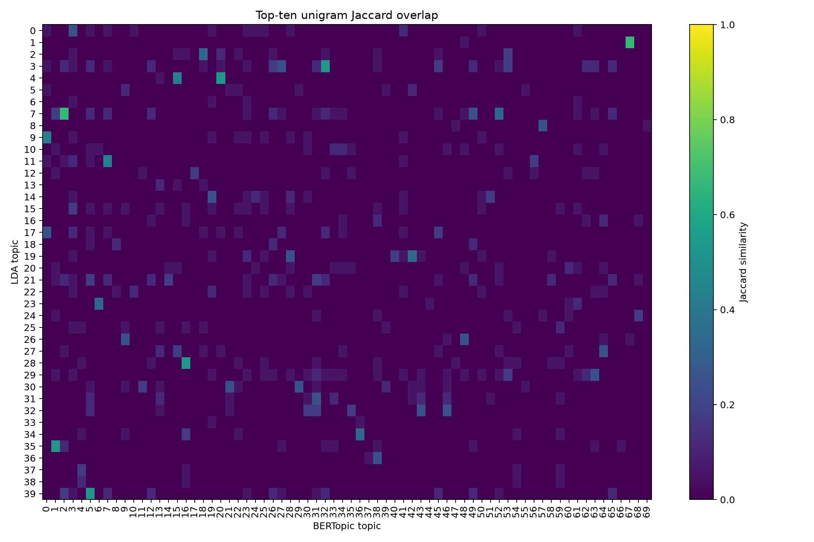
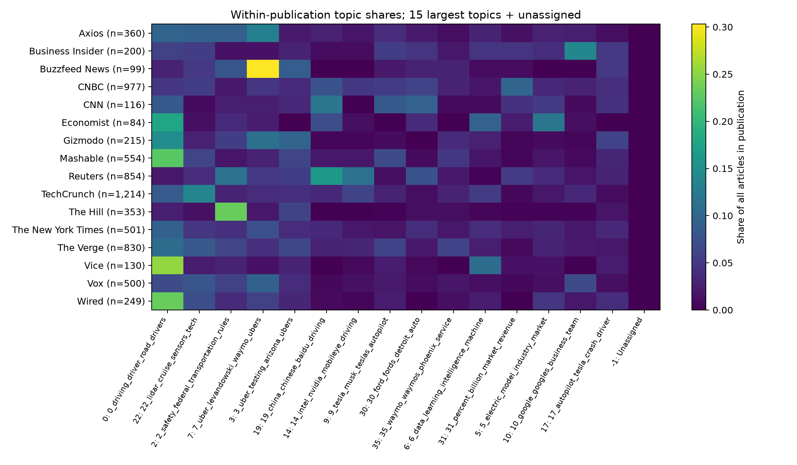
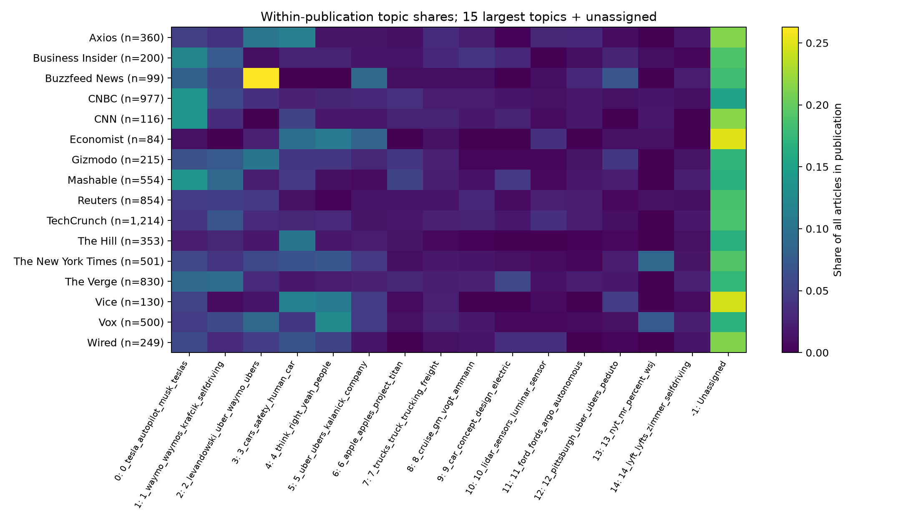

# PR3 results and interpretation notes

Prepared November 25, 2026 on `mkc/model-comparison`. This is a separate handoff document; the PR3 manuscript, existing tables and figures have not been edited.

## Current status and main findings

Mary Kate explicitly selected **BERTopic n30_c25_s42** after reviewing the shortlist recommendation. Both selected pipelines have now been evaluated on the same 7,332-article corpus. The six original BERTopic seed-42 fits and original LDA numerical exports were reused. BERTopic seeds 7 and 21 were added. All topic names below are **assistant drafts, not team-confirmed labels**. Independent human evaluation remains pending; no review packets or human ratings were created.

The two methods recover recognizable deployment, regulation, safety, litigation, supply-chain and mobility themes. BERTopic has higher mean coherence, while LDA has higher keyword diversity and assigns every article. BERTopic retains a substantial unassigned group. Neither model is uniformly superior on these measures, and these exploratory results do not establish human-perceived accuracy or out-of-sample generalization.

## Model selection and development evidence

| BERTopic run | Topics | Mean c_v | Diversity | Unassigned | Cosine silhouette |
| --- | --- | --- | --- | --- | --- |
| n15_c25_s42 | 76 | 0.6921 | 0.6434 | 20.24% | 0.1144 |
| n15_c50_s42 | 40 | 0.6622 | 0.6225 | 19.93% | 0.1192 |
| n15_c100_s42 | 21 | 0.6408 | 0.5857 | 14.61% | 0.1050 |
| n30_c25_s42 | 70 | 0.7047 | 0.6514 | 18.04% | 0.1217 |
| n30_c50_s42 | 35 | 0.6455 | 0.6000 | 19.08% | 0.1227 |
| n30_c100_s42 | 24 | 0.6295 | 0.6083 | 22.20% | 0.1340 |

Source: [six-run experiment table](../code/modern-methods/Results/modern/experiments.csv). Silhouette uses original normalized embeddings, excludes outliers and samples at most 2,000 assigned articles; it is not directly comparable with an LDA score.

The primary shortlist was n30_c25_s42, n15_c25_s42 and n15_c50_s42. The selected run improves coherence and assignment coverage over the other two shortlisted runs while preserving specific themes in the examined articles. The 40-topic n15_c50 alternative offers coarser summaries, but matching LDA's topic count is not itself a quality criterion. The 21-topic n15_c100 run has the lowest unassigned fraction and is a credible coverage-focused alternative; n30_c50 and n30_c100 provide different coarse partitions without leading on coherence. Model choice is a documented exploratory tradeoff, not a statistically established optimum.

The [current shortlist review](../code/modern-methods/selection_review/current_shortlist_review.csv) covers each candidate's five largest, three lowest-coherence and three smallest assigned topics, deduplicated within run: **33 topic/run pairs and 70 distinct articles**. It records current representative IDs and manifest hashes. Review used keywords, titles, and opening/middle/ending article passages; it was not an exhaustive reading of approximately 119,000 words of full text. These are assistant development assessments, not independent human scores. No cited development IDs intersect the 100 reserved review IDs. The older suggested-score CSV remains historical evidence and does not consistently correspond to current topic IDs/examples.

Examples supporting the choice include Uber-Waymo litigation (1341648, 1450043, 1921486), Waymo deployment (546719, 484629, 546490), Roborace (1112028, 540914, 534886), and Las Vegas autonomous rides (548701, 845221, 549015). Counterexamples include TechCrunch roundups (411242, 323085, 360683), mixed transportation newsletters (449680, 270478, 498671), and conversational technology essays/interviews (218059, 1335182, 138257). Agreement among syndicated or near-duplicate stories is not independent evidence of general cluster quality.

The authoritative choice and selector are recorded in [selection.json](../code/modern-methods/Results/modern/selection.json).

## Data, configurations and evaluation definitions

The shared audited corpus contains **7,332 articles from 25 publications**, dated January 2016 through March 26, 2020. Exact duplicate article bodies were removed; near duplicates, updates and syndicated text can remain. Both pipelines use corpus hash `c73293f76ba4b0a18d685e5724f75b1123a86c9012497fc324090989642a8f99`. The 100 reserved articles are excluded from development examples and naming, not from unsupervised model fitting.

- **LDA:** seed 42, K=40, batch variational fitting, 50 iterations, document-topic prior 0.1, topic-word prior 0.025. Unigram counts use shared tokenization plus English/custom stopword removal, exclusion of digit-only and short tokens, min_df=5 and max_df=0.5. Full mixtures are preserved alongside dominant assignments. [Selected configuration](../code/classical-methods/selected_configuration.json); [manifest](../code/classical-methods/results/manifest.json).
- **BERTopic:** normalized 384-dimensional GTE-small embeddings; tokenizer chunks of at most 480 tokens; token-weighted pooling. UMAP: 30 neighbors, 5 components, cosine metric, min_dist=0, seed 42. HDBSCAN: min_cluster_size=25, min_samples=10, Euclidean metric, excess-of-mass selection, prediction_data=True. Topic representations use c-TF-IDF with a fixed unigram vocabulary learned from individual articles (min_df=5, English stopwords). [Run manifest](../code/modern-methods/Results/modern/runs/n30_c25_s42/manifest.json); [embedding provenance](../code/modern-methods/Results/modern/embedding_pointer.json).
- **Coherence:** mean per-topic c_v using the top ten unigrams and the same shared full-corpus reference/tokenizer, window size 110; BERTopic topic -1 excluded. Vocabulary coverage is reported explicitly.
- **Keyword diversity:** distinct terms divided by all top-ten term slots across assigned topics.
- **Jaccard:** intersection divided by union of the two top-ten word sets. Best lexical matches retain ties and are not proof of semantic equivalence or a one-to-one alignment.
- **Publication shares:** dominant-topic article counts divided by all corpus articles from that publication. All 25 outlets remain separate, including Vice and Vice News. BERTopic outliers stay in denominators. Main heatmaps show the 15 largest topics plus unassigned for outlets with at least 50 articles; displayed subsets need not sum to one.
- **LDA mixture shares:** the existing PR3 heatmap averages full topic probabilities. It answers a different question from dominant-assignment proportions and must be captioned separately. Its outlet grouping also differs from these comparison tables.

## Quantitative comparison

| Model | Topics | Mean c_v | Keyword diversity | Vocabulary coverage | Unassigned |
| --- | --- | --- | --- | --- | --- |
| bertopic | 70 | 0.7047 | 0.6514 | 100.0% | 18.04% |
| lda | 40 | 0.6552 | 0.7100 | 100.0% | 0.00% |

Sources: [model metrics](../code/modern-methods/Results/comparison/n30_c25_s42/model_metrics.csv), [per-topic LDA coherence](../code/modern-methods/Results/comparison/n30_c25_s42/classical_coherence.csv), [per-topic BERTopic coherence](../code/modern-methods/Results/comparison/n30_c25_s42/modern_coherence.csv). BERTopic leaves **1,323 articles unassigned**; that category is not a substantive topic. The 0.0495 difference in mean coherence is descriptive, not a significance test, and the models have different numbers and granularities of topics.

[Mixture checks](../code/modern-methods/Results/comparison/n30_c25_s42/classical_validation.json) confirm normalized rows, correct IDs, and agreement with dominant assignments and membership strengths. LDA's mean dominant probability is 0.4382 and median is 0.3974; 68.71% of articles have no topic probability above 0.5. This reflects mixed-topic representation, not measured error or calibrated prediction confidence.

## Seed stability and its limits

| Model | Comparison seed | ARI | Articles evaluated | Corpus evaluated | Outlier-status agreement |
| --- | --- | --- | --- | --- | --- |
| bertopic | 7 | 0.9614 | 5697 | 77.70% | 91.04% |
| bertopic | 21 | 0.9760 | 5678 | 77.44% | 91.13% |
| lda | 7 | 0.3230 | 7332 | 100.00% | 100.00% |
| lda | 21 | 0.3469 | 7332 | 100.00% | 100.00% |

Source: [seed stability](../code/modern-methods/Results/comparison/n30_c25_s42/seed_stability.csv). All comparisons use the seed-42 model as baseline. LDA ARI covers every article. BERTopic ARI covers only articles assigned in both runs: its high values must be reported together with the approximately 77.5% evaluated fraction and approximately 91% outlier-status agreement. LDA's outlier agreement of 100% is automatic because it has no outlier class.

BERTopic stability does not mean every topic or publication conclusion persists. Topic matching leaves six baseline topics unmatched at seed 7 and four at seed 21, with descriptive split/merge flags. For matched topic/outlet rows with at least 50 articles, the median absolute publication-share change is zero, but the 95th percentile is 0.99 percentage points (seed 7) and 0.91 (seed 21). Maximum changes are 9.38 points for the NYT business-roundup match at seed 7 and 7.65 points for The Hill policy-newsletter match at seed 21. These summaries exclude unmatched topics and therefore cannot establish stability of the entire partition. See [seed 7 matches and publication changes](../code/modern-methods/Results/modern/selected/n30_c25_s42/seed_7/publication_changes.csv) and [seed 21](../code/modern-methods/Results/modern/selected/n30_c25_s42/seed_21/publication_changes.csv).

LDA's ARIs of 0.323 and 0.347 indicate substantial seed sensitivity in dominant assignments. Matched LDA publication sensitivity has not been computed here; do not claim its publication patterns are stable.

## Findings for the research questions

### 1. What themes characterize AV news coverage?

Both methods identify Tesla/Autopilot, Waymo deployment, Uber-Waymo litigation, autonomous freight, safety regulation, automotive suppliers and urban mobility. Examples include LDA 7 / BERTopic 2 (litigation), LDA 35 / BERTopic 1 (Waymo), LDA 11 / BERTopic 7 (trucking), and LDA 4 / BERTopic 20 (Congress). These are provisional, article-supported descriptions; the complete draft inventories below expose weak topics as well as strong ones.

### 2. How do themes differ across publications?

The following illustrative comparisons use identical publication denominators. They are examples, not exhaustive rankings or tests of editorial intent.

| Draft theme (LDA / modern ID) | Publication | N | LDA count / share | BERTopic count / share |
| --- | --- | --- | --- | --- |
| Congressional legislation (4 / 20) | The Hill | 353 | 120 / 33.99% | 29 / 8.22% |
| Litigation (7 / 2) | Vox | 500 | 47 / 9.40% | 44 / 8.80% |
| Litigation (7 / 2) | Reuters | 854 | 43 / 5.04% | 37 / 4.33% |
| Waymo deployment (35 / 1) | The Verge | 830 | 51 / 6.14% | 77 / 9.28% |
| Waymo deployment (35 / 1) | TechCrunch | 1214 | 37 / 3.05% | 85 / 7.00% |
| Urban mobility (28 / 16) | Wired | 249 | 35 / 14.06% | 5 / 2.01% |
| Hill.TV interviews (1 / 67) | The Hill | 353 | 27 / 7.65% | 27 / 7.65% |

Sources: [LDA counts](../code/modern-methods/Results/comparison/n30_c25_s42/classical/publication_counts.csv), [BERTopic counts](../code/modern-methods/Results/comparison/n30_c25_s42/modern/publication_counts.csv), [matched shares](../code/modern-methods/Results/comparison/n30_c25_s42/matched_publication_proportions.csv).

The Hill's congressional coverage appears in both pipelines, but its magnitude differs substantially. Vox's litigation share exceeds Reuters' in both shown comparisons. The Verge's Waymo share exceeds TechCrunch's in both, although the BERTopic topic is broader. Wired's apparent urban-mobility emphasis changes sharply between models; keyword matching alone does not preserve the substantive conclusion. All 27 articles in both Hill.TV topics come from The Hill, illustrating how a publication-specific format can look like thematic specialization.

Unequal outlet dates, article counts, syndication and source-specific formats are alternative explanations. These are corpus-specific descriptive associations, not causal claims or measures of all output published by an outlet.

### 3. How does model choice affect the themes identified?

- **Shared themes:** LDA 7 / BERTopic 2 have Jaccard 0.667, with 319 of LDA 7's 409 articles assigned to BERTopic 2. LDA 35 / BERTopic 1 have Jaccard 0.538, with 195 of 211 articles overlapping.
- **Splitting:** LDA 3 groups Uber testing/crash stories. Its 356 articles distribute across BERTopic's fatal crash (68), California permit dispute (66), testing restart (57), NTSB investigation (30), and other topics; 61 are unassigned. A single best keyword match omits this structure.
- **Merging:** BERTopic 0 contains 227 articles from LDA's Tesla product topic 9 and 152 from its Tesla crash-investigation topic 17. More total topics does not imply finer separation of every theme.
- **Supplier detail:** LDA 14's 290 articles divide between Intel-Mobileye (78), Nvidia (60), other assigned topics and 72 outliers in BERTopic.
- **Shared failure modes:** the Hill.TV topics have Jaccard 0.667, matching the strong litigation overlap numerically. High overlap can capture formatting or source identity, not only valuable themes. BERTopic 47 also has embedded page-code terms; the corpus audit did not remove all page artifacts.

Sources: [assignment contingency](../code/modern-methods/Results/comparison/n30_c25_s42/assignment_contingency.csv) and [lexical matches with ties](../code/modern-methods/Results/comparison/n30_c25_s42/best_lexical_matches.csv). Do not equate every automatic best match with semantic equivalence.

## Figures for PR3 consideration

These are new comparison artifacts; no existing PR3 figures were replaced. The full 40-by-70 overlap plot is best viewed full width or as a supplement. Topic IDs can be resolved through the draft inventories. Publication heatmaps retain keyword labels until the team confirms names; draft labels must not be presented as confirmed.







PDF counterparts are saved alongside these PNGs. The two publication plots use their own color scales: compare numeric shares rather than matching colors between plots.

## Runtime and reproducibility boundaries

The selected BERTopic seed-42 run records 10.05 seconds for fitting/representation and 22.61 seconds for evaluation. Shared embedding preparation records 100.68 seconds for embeddings and 0.31 seconds for model loading/download-stage accounting; the latter does not establish a fresh network-download cost. Embeddings are reused by all configurations. LDA stage timings and original hardware context are unavailable, so no comparative speed ranking is supported. [Timing table](../code/modern-methods/Results/comparison/n30_c25_s42/runtime_comparison.csv); [hardware/stage context](../code/modern-methods/Results/comparison/n30_c25_s42/runtime_context.json).

## Corrections and remaining work for PR3

1. Replace the older methodology statement of 100 iterations and symmetric default priors with the selected LDA settings: 50 iterations, alpha=0.1, eta=0.025. Preserve the distinction between historical tuning runs and the final fit.
2. Update statements that assignments, topic mixtures, model selection or numerical comparison are planned; they are now available. Topic names are still drafts, and human evaluation is pending.
3. The prior-search prose lists four values while its tables include 1.0; reconcile the description. Describe the choice of alpha as an exploratory interpretability tradeoff, not validated assignment confidence. The supplied training-perplexity/prior tables were not independently refitted here.
4. Distinguish the existing average-mixture heatmap from the new dominant-topic comparison; document different Vice/Vice News grouping. Never combine the two estimands in a single unlabeled metric.
5. Use actual [PR2 feedback](../progress-report-2/pr2-feedback.tex), which asks for themes and publication comparisons. The examples above support a substantive response; this document does not edit or complete the formal response memo.
6. Confirm topic labels using nonreserved article evidence, then prepare frozen packets and collect both reviewers' independent ratings. Human columns remain blank; no kappa, fit-rating averages or intervals can be reported yet.
7. Complete shared-period publication sensitivity and decide the held-out protocol for the final report. Full-corpus tuning has already occurred; a retrospective split cannot be described as an untouched final test. Learn vocabulary and fit models only on training data for any split-based diagnostic, with a documented rare-stratum policy.
8. Treat the ordinal-regression placeholder as unimplemented until its research purpose and design are agreed. Do not imply it was completed.
9. Disclose assistant use for code, developmental passage review, draft labeling and writing support. The team remains responsible for interpretation, references and final manuscript claims. No new literature claims or unverified citations are supplied here.

## Reproduction and checks

From the repository root, use the existing locked environment (`uv sync` if needed):

```sh
uv run python final-project/code/modern-methods/verify_notebooks.py
uv run python final-project/code/modern-methods/verify_notebooks.py --execute 02 03 comparison
PYTHONPATH=final-project/code/modern-methods:final-project/code MPLBACKEND=Agg uv run python -m unittest discover -s final-project/code/modern-methods/tests -v
```

Existing corpus and embedding caches are required; on a new checkout, run notebook 01 first to reconstruct the audited corpus and embeddings. Large caches/models and full-text development examples remain ignored by Git. Original run manifests bind corpus, embedding, code and environment identities; do not bypass a mismatch. The comparison itself reads saved exports and does not refit either model. The Markdown handoff is an editorial snapshot: after changing inputs, rerun comparisons and reconcile these statements with the resulting CSVs.

Draft edits live in [modern draft labels](../code/modern-methods/Results/comparison/n30_c25_s42/modern_draft_labels.csv) and [classical draft labels](../code/modern-methods/Results/comparison/n30_c25_s42/classical_draft_labels.csv), separate from authoritative model exports and the team-confirmation workflow. Rerunning comparison preserves these edits and validates evidence IDs. [Current evidence checklist](../code/modern-methods/Results/comparison/n30_c25_s42/comparison_evidence_checklist.csv) and [comparison status](../code/modern-methods/Results/comparison/status.json) identify remaining work.

## Complete draft topic inventories

The following labels are assistant suggestions. Evidence IDs refer to corpus article IDs and are excluded from the reserved review sample. For all-topic naming, evidence was limited to top terms and representative titles/leads; the deeper opening/middle/ending passage review applies only to the shortlist topics described above. Each draft-label CSV contains the corresponding titles and evidence notes; neither constitutes independent human evaluation. Shares use all 7,332 articles, including BERTopic outliers in the denominator.

### LDA draft inventory

| Topic | Draft label | Articles | Corpus share | Top keywords | Evidence IDs |
| --- | --- | --- | --- | --- | --- |
| 0 | Driving automation and human control | 685 | 9.34% | driving, driver, road, drivers, human | 354378  /  1071107  /  834089 |
| 1 | Hill.TV Boundless technology interviews | 27 | 0.37% | boundless, aired, smart, hilltvs, interview | 1819183  /  1816307  /  1817789 |
| 2 | Federal AV policy and safety regulation | 431 | 5.88% | safety, federal, transportation, rules, regulations | 1176973  /  1238961  /  1267035 |
| 3 | Uber testing and crash response | 356 | 4.86% | uber, testing, arizona, ubers, safety | 33732  /  2735919  /  320592 |
| 4 | Congressional AV legislation | 131 | 1.79% | hill, house, senate, trump, committee | 1861945  /  1859703  /  1750939 |
| 5 | Electric-vehicle products and industry | 198 | 2.70% | electric, model, industry, market, production | 1524974  /  2774572  /  213962 |
| 6 | Artificial intelligence and machine learning | 201 | 2.74% | data, learning, intelligence, machine, artificial | 466029  /  446064  /  439902 |
| 7 | Uber-Waymo trade-secret litigation | 409 | 5.58% | uber, levandowski, waymo, ubers, google | 61037  /  331985  /  1115380 |
| 8 | Robotics education and entrepreneurs | 32 | 0.44% | robotics, thrun, udacity, students, robot | 1488073  /  514974  /  300559 |
| 9 | Tesla Autopilot products and upgrades | 257 | 3.51% | tesla, musk, teslas, autopilot, model | 335766  /  387235  /  912821 |
| 10 | Google AV teams and technology careers | 198 | 2.70% | google, googles, business, team, tech | 524536  /  304215  /  2524988 |
| 11 | Autonomous trucking and freight | 111 | 1.51% | trucks, truck, trucking, otto, drivers | 1850605  /  1411519  /  814542 |
| 12 | Autonomous delivery robots and services | 187 | 2.55% | delivery, customers, amazon, nuro, robots | 1593360  /  1637962  /  345405 |
| 13 | Politics and peripheral coverage (mixed) | 49 | 0.67% | trump, president, trumps, campaign, white | 2534432  /  1676225  /  624005 |
| 14 | AV computing platforms and suppliers | 290 | 3.96% | intel, nvidia, mobileye, driving, systems | 477459  /  1516649  /  1296775 |
| 15 | Mobility adoption, costs and traffic | 166 | 2.26% | transportation, driving, driverless, industry, future | 1098259  /  1020917  /  455502 |
| 16 | Future urban vehicles (mixed examples) | 70 | 0.95% | city, university, bus, local, driverless | 2009473  /  1495239  /  544945 |
| 17 | Tesla Autopilot crash investigations | 192 | 2.62% | autopilot, tesla, crash, driver, safety | 2281329  /  2270568  /  2281596 |
| 18 | Uber Jacobs letter and surveillance allegations | 67 | 0.91% | letter, jacobs, reuters, information, san | 1559538  /  307852  /  2074983 |
| 19 | China autonomous-vehicle industry | 345 | 4.71% | china, chinese, baidu, driving, toyota | 49182  /  190212  /  975756 |
| 20 | Cloud and internet technology (mixed) | 50 | 0.68% | amazon, users, internet, cloud, google | 1010446  /  541848  /  512924 |
| 21 | Ride-hailing services and partnerships | 83 | 1.13% | lyft, uber, drivers, ridehailing, lyfts | 1370734  /  1106279  /  41150 |
| 22 | Lidar and autonomous-driving suppliers | 511 | 6.97% | lidar, cruise, sensors, tech, working | 301249  /  143578  /  296721 |
| 23 | Apple Project Titan strategy | 130 | 1.77% | apple, apples, project, iphone, navigation | 563870  /  293607  /  2052862 |
| 24 | Autonomous passenger-service pilots | 171 | 2.33% | service, ride, passengers, rides, riders | 477437  /  833507  /  527245 |
| 25 | Automation, jobs and labor | 121 | 1.65% | people, jobs, work, percent, workers | 466492  /  148461  /  1495775 |
| 26 | CES and future vehicle concepts | 141 | 1.92% | ces, tech, future, smart, concept | 548736  /  850916  /  532278 |
| 27 | Business and political news roundups | 141 | 1.92% | facebook, trump, news, president, report | 1568922  /  2348972  /  2490256 |
| 28 | Urban planning and shared mobility | 176 | 2.40% | cities, city, transportation, parking, people | 1102677  /  2335539  /  237316 |
| 29 | AV road testing and incidents | 173 | 2.36% | miles, testing, test, roads, california | 477658  /  301907  /  514133 |
| 30 | Ford and automaker alliances | 224 | 3.06% | ford, fords, detroit, auto, automakers | 1651888  /  253602  /  47374 |
| 31 | Corporate financial performance | 201 | 2.74% | percent, billion, market, revenue, stock | 1161665  /  1462192  /  152618 |
| 32 | Technology investment and funding | 106 | 1.45% | billion, million, investment, raised, capital | 2453472  /  2399493  /  2402204 |
| 33 | Connected-vehicle cybersecurity | 53 | 0.72% | security, systems, cybersecurity, military, hackers | 244200  /  446581  /  89830 |
| 34 | Flying vehicles and future transportation | 67 | 0.91% | flying, air, transportation, drones, people | 404356  /  1117698  /  1335569 |
| 35 | Waymo driverless-service rollout | 211 | 2.88% | waymo, waymos, phoenix, service, chrysler | 2340111  /  334772  /  319625 |
| 36 | International AV trials and readiness | 22 | 0.30% | london, transport, driverless, trial, british | 1605083  /  1622181  /  1560368 |
| 37 | Interviews and conversational transcripts | 132 | 1.80% | people, really, know, yeah, things | 28936  /  24876  /  52032 |
| 38 | Warren Buffett and business interviews | 61 | 0.83% | know, quick, people, buffett, warren | 1436382  /  1436761  /  1539403 |
| 39 | Uber leadership and corporate culture | 156 | 2.13% | uber, ubers, kalanick, ceo, khosrowshahi | 115008  /  1922977  /  130075 |

Full ten-term keywords, coherence and evidence notes: [classical inventory](../code/modern-methods/Results/comparison/n30_c25_s42/classical_draft_inventory.csv).

### BERTopic draft inventory

| Topic | Draft label | Articles | Corpus share | Top keywords | Evidence IDs |
| --- | --- | --- | --- | --- | --- |
| 0 | Tesla Autopilot capabilities and safety promises | 538 | 7.34% | tesla, autopilot, musk, teslas, model | 546160  /  1133411  /  567033 |
| 1 | Waymo driverless-service development | 438 | 5.97% | waymo, waymos, krafcik, selfdriving, phoenix | 546719  /  484629  /  546490 |
| 2 | Uber-Waymo trade-secret litigation | 334 | 4.56% | levandowski, uber, waymo, ubers, waymos | 1341648  /  1450043  /  1921486 |
| 3 | AV safety and deployment readiness | 302 | 4.12% | cars, safety, human, car, selfdriving | 150859  /  2675771  /  672266 |
| 4 | Technology interviews and essays (mixed themes) | 265 | 3.61% | think, right, yeah, people, know | 218059  /  1335182  /  138257 |
| 5 | Uber leadership and corporate governance | 190 | 2.59% | uber, ubers, kalanick, company, drivers | 1231901  /  535564  /  1353575 |
| 6 | Apple Project Titan strategy | 161 | 2.20% | apple, apples, project, titan, car | 1486861  /  2052862  /  1998813 |
| 7 | Autonomous trucking and freight | 152 | 2.07% | trucks, truck, trucking, freight, otto | 2069818  /  814542  /  1526226 |
| 8 | GM Cruise development and partnerships | 148 | 2.02% | cruise, gm, vogt, ammann, gms | 2598365  /  514832  /  559507 |
| 9 | Future vehicle design and CES concepts | 145 | 1.98% | car, concept, design, electric, like | 548981  /  1590969  /  527272 |
| 10 | Lidar sensing technology | 123 | 1.68% | lidar, sensors, luminar, sensor, velodyne | 1341492  /  317007  /  2042316 |
| 11 | Ford autonomous-vehicle deployment | 117 | 1.60% | ford, fords, argo, autonomous, vehicles | 524986  /  2308500  /  1914123 |
| 12 | Uber passenger trials in Pittsburgh | 113 | 1.54% | pittsburgh, uber, ubers, peduto, selfdriving | 1928645  /  55997  /  83576 |
| 13 | DealBook business-news roundups | 113 | 1.54% | nyt, mr, percent, wsj, trump | 2079697  /  2088722  /  2086745 |
| 14 | Lyft autonomous-driving partnerships | 112 | 1.53% | lyft, lyfts, zimmer, selfdriving, gm | 542075  /  177858  /  540126 |
| 15 | Hillicon Valley policy newsletters | 101 | 1.38% | trump, house, senate, committee, democrats | 1850805  /  1841915  /  1828997 |
| 16 | Urban planning, parking and mobility | 100 | 1.36% | cities, parking, city, transportation, urban | 1438428  /  545815  /  14117 |
| 17 | Autonomous grocery and goods delivery | 99 | 1.35% | delivery, nuro, grocery, kroger, pizza | 565873  /  556197  /  1519045 |
| 18 | Federal AV safety guidance | 97 | 1.32% | guidelines, safety, nhtsa, federal, administration | 1682395  /  1691665  /  538680 |
| 19 | Intel-Mobileye acquisition and technology | 95 | 1.30% | mobileye, intel, delphi, mobileyes, intels | 69258  /  2053572  /  341476 |
| 20 | Congressional AV legislation | 85 | 1.16% | legislation, senate, safety, committee, house | 2490394  /  1710933  /  1767208 |
| 21 | Ford-Volkswagen autonomous and EV alliance | 80 | 1.09% | vw, ford, volkswagen, electric, argo | 1651326  /  1651889  /  253602 |
| 22 | Transportation newsletters (mixed themes) | 79 | 1.08% | scooters, week, scooter, electric, new | 449680  /  270478  /  498671 |
| 23 | Toyota autonomous-driving research | 77 | 1.05% | toyota, toyotas, tokyo, research, vehicle | 551428  /  2384103  /  70943 |
| 24 | Nvidia autonomous-driving computing | 76 | 1.04% | nvidia, nvidias, px, drive, huang | 545646  /  410793  /  538833 |
| 25 | Daimler-Bosch autonomous taxis | 76 | 1.04% | daimler, bosch, bmw, mercedesbenz, german | 1237413  /  1149101  /  842319 |
| 26 | Uber California testing-permit dispute | 69 | 0.94% | dmv, permit, uber, california, francisco | 76152  /  1917376  /  1436769 |
| 27 | Fatal Uber pedestrian crash in Tempe | 69 | 0.94% | tempe, police, vasquez, herzberg, crash | 1122687  /  56383  /  45666 |
| 28 | Baidu Apollo platform | 66 | 0.90% | baidu, apollo, baidus, chinese, platform | 537741  /  1078023  /  464208 |
| 29 | Ford leadership transition | 62 | 0.85% | ford, fords, hackett, fields, detroit | 2039175  /  539365  /  497304 |
| 30 | Autonomous-driving startups and funding | 61 | 0.83% | startups, autonomous, companies, fiveai, software | 308545  /  1515359  /  91911 |
| 31 | Ride-hailing competition and IPOs | 61 | 0.83% | lyft, lyfts, ipo, uber, billion | 692064  /  2139832  /  1458437 |
| 32 | Uber testing suspension and restart | 58 | 0.79% | arizona, uber, testing, crash, safety | 562777  /  1499709  /  1189527 |
| 33 | Alphabet corporate structure and earnings | 51 | 0.70% | alphabet, google, revenue, growth, bets | 2490050  /  2376309  /  1955309 |
| 34 | Google self-driving bus collision | 50 | 0.68% | bus, google, googles, car, cars | 1098819  /  751753  /  40130 |
| 35 | Aurora financing and Amazon investment | 50 | 0.68% | aurora, amazon, urmson, auroras, amazons | 564426  /  435632  /  1006766 |
| 36 | Flying vehicles and future transportation | 48 | 0.65% | flying, aircraft, air, flight, kitty | 1360222  /  117070  /  404356 |
| 37 | Singapore autonomous-taxi trials | 47 | 0.64% | singapore, nutonomy, grab, singapores, nutonomys | 929989  /  527245  /  525516 |
| 38 | UK driverless-vehicle trials | 47 | 0.64% | london, uk, trials, driverless, transport | 71054  /  1364107  /  528287 |
| 39 | GM electric and autonomous strategy | 45 | 0.61% | gm, barra, gms, electric, plant | 1644777  /  671140  /  2641130 |
| 40 | Didi autonomous ride services in China | 45 | 0.61% | didi, china, ponyai, chuxing, didis | 2170291  /  2163786  /  528014 |
| 41 | Driver-assistance levels and deployment | 43 | 0.59% | audi, level, nissan, driving, propilot | 837069  /  27189  /  89919 |
| 42 | China autonomous-vehicle industry | 41 | 0.56% | china, chinese, chinas, tencent, baidu | 1970500  /  729270  /  1509486 |
| 43 | SoftBank mobility investments | 41 | 0.56% | softbank, billion, son, investment, toyota | 1626427  /  1350512  /  104855 |
| 44 | Hyundai autonomous-driving investments | 40 | 0.55% | hyundai, samsung, south, aptiv, korean | 2371625  /  2295524  /  2365286 |
| 45 | NTSB investigation of Uber fatal crash | 39 | 0.53% | ntsb, crash, safety, herzberg, uber | 2456475  /  554820  /  3798 |
| 46 | Startup demo-day roundups | 39 | 0.53% | million, startups, startup, rank, raised | 479036  /  328851  /  287307 |
| 47 | TechCrunch event promotion and page artifacts | 39 | 0.53% | pm, iframe, var, function, mobility | 2699915  /  2569888  /  296717 |
| 48 | CES technology previews | 38 | 0.52% | ces, devices, year, vr, smart | 2557319  /  1110676  /  1424324 |
| 49 | Uber Jacobs letter and litigation evidence | 36 | 0.49% | jacobs, letter, uber, ubers, padilla | 2069482  /  63812  /  1928724 |
| 50 | Volvo autonomous-driving program | 35 | 0.48% | volvo, volvos, autonomous, driving, samuelsson | 548169  /  711747  /  115506 |
| 51 | CNBC stock-market commentary | 35 | 0.48% | cramer, intel, nvidia, mad, stock | 1457325  /  1458241  /  1532111 |
| 52 | Levandowski criminal indictment | 35 | 0.48% | levandowski, google, anthony, indictment, theft | 2163686  /  2166447  /  2349311 |
| 53 | California driverless-testing regulations | 34 | 0.46% | california, dmv, state, regulations, vehicles | 545698  /  811330  /  2080520 |
| 54 | Ethical dilemmas and AV safety | 33 | 0.45% | moral, trolley, ethical, people, decisions | 521891  /  1985714  /  5586 |
| 55 | Vehicle electrification and energy | 33 | 0.45% | electric, oil, charging, evs, vehicles | 548026  /  392330  /  2700084 |
| 56 | TuSimple autonomous freight delivery | 32 | 0.44% | tusimple, ups, trucks, usps, mail | 2440714  /  568166  /  2163395 |
| 57 | Udacity autonomous-driving education | 32 | 0.44% | udacity, thrun, nanodegree, students, udacitys | 544717  /  383442  /  1537770 |
| 58 | Car ownership and mobility services | 32 | 0.44% | car, ownership, companies, ridehailing, services | 672259  /  45601  /  533196 |
| 59 | Public trust and acceptance surveys | 31 | 0.42% | percent, survey, americans, respondents, poll | 554685  /  952202  /  527538 |
| 60 | TechCrunch news roundups | 30 | 0.41% | crunch, daily, apple, inbox, app | 411242  /  323085  /  360683 |
| 61 | High-definition mapping for AVs | 30 | 0.41% | maps, mapping, map, data, navigation | 645141  /  2028370  /  67860 |
| 62 | Michigan autonomous-vehicle test sites | 28 | 0.38% | michigan, mcity, university, testing, test | 1476870  /  2050252  /  1983301 |
| 63 | California disengagement reports | 28 | 0.38% | miles, disengagements, disengagement, california, testing | 564695  /  2690277  /  550108 |
| 64 | NYT Week in Tech discussions | 28 | 0.38% | farhad, mike, news, week, tech | 2039030  /  2034220  /  2044257 |
| 65 | Uber-Volvo autonomous XC90 partnership | 27 | 0.37% | volvo, uber, xc90, selfdriving, ubers | 12810  /  1643672  /  174372 |
| 66 | Automaker mergers and alliances | 27 | 0.37% | fiat, renault, chrysler, merger, psa | 2383045  /  1032439  /  2149836 |
| 67 | Hill.TV Boundless technology interviews | 27 | 0.37% | boundless, aired, hilltvs, 5g, hilltv | 1814127  /  1824634  /  1837582 |
| 68 | Las Vegas autonomous rides | 26 | 0.35% | vegas, las, shuttle, aptiv, lyft | 548701  /  845221  /  549015 |
| 69 | Roborace autonomous racing | 25 | 0.34% | roborace, formula, racing, robocar, race | 1112028  /  540914  /  534886 |

Full ten-term keywords, coherence and evidence notes: [modern inventory](../code/modern-methods/Results/comparison/n30_c25_s42/modern_draft_inventory.csv).

